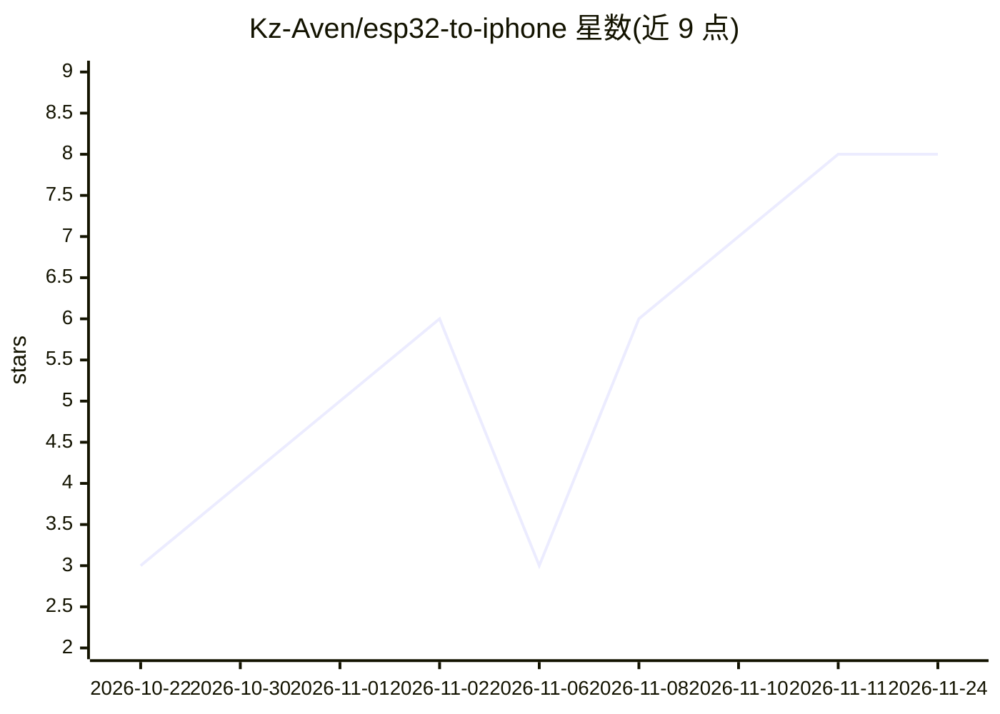

# Kz-Aven/esp32-to-iphone

⭐ 8 · Python · MIT · 推送 2026-10-18 · [GitHub](https://github.com/Kz-Aven/esp32-to-iphone) · 个人维护 · 中文 README

**用 ESP32-S3 硬件让 AI Agent 通过 MCP 控制真实 iPhone**

由 ESP32-S3 开发板、AirPlay 屏幕镜像与本地 MCP 服务组成的手机自动化链路：ESP32-S3 模拟 USB 鼠标键盘执行点击、滑动与输入，AirPlay 提供屏幕画面，截图与操作封装为 16 个 MCP 工具，由具备视觉能力的宿主 Agent（如 Codex）看图决策并核对结果。面向想用 AI Agent 自动化 iPhone 操作的用户。无需越狱、开发者账号或手机端 App；已实测路径为 macOS Apple Silicon + N16R8 开发板 + Lightning iPhone，控制接口无认证、须限于可信局域网。

## 筛选速览

| 维度 | 判定 | 备注 |
|---|---|---|
| AI 角色 | `ai-ecosystem` | LLM/agent 周边工具 |
| 许可风险 | `permissive` | MIT |
| 部署形态 | `None` |  |
| 模型依赖 | — | README 未给出锁定关系 |
| 硬件要求 | — | 无带数字的原话,不猜 |
| 安装摩擦 | `low` | 无编译、无系统依赖或容器化 |
| 成熟度 | — | 结构信号不足 |

## 能力要点

- ESP32-S3 模拟 USB HID 鼠标键盘，操作无需越狱与开发者账号
- 16 个 MCP 工具：截图、指针定位、点击、滑动、滚动、键盘与中文拼音选词输入
- 每次动作返回截图供 Agent 验证上一步，点击前由本地算法校验指针位置
- 默认使用宿主 Agent 自身的视觉模型，不串联第二个模型

## 适用场景

- 让视觉 Agent 代为读取微信消息并拟好回复草稿
- 自动化朋友圈点赞等重复性手机操作
- 通过对话驱动 iPhone 完成多步 App 操作任务

## 场景标签

`GUI 自动化` · 领域:效率与自动化

## 证据(README 行号)

> L1: # ESP32 to iPhone：通过 MCP 让 AI Agent 控制真实 iPhone
> L11: ESP32 to iPhone 是一个低成本的 iPhone 自动化与 MCP 手机控制项目：用 AirPlay 获取屏幕画面，用 ESP32-S3 模拟 USB 鼠标和键盘，再把截图、点击、滑动、输入等能力封装成 MCP 工具。

## 星数曲线

2026-10-22 3 → 2026-11-24 8（+5）

---
*卡片 v1 · prompt 1.4 · 生成 2026-11-20 · 置信度 high · 依据 README sha `b331275184eb` · [字段定义](../../DATASET.md)*
