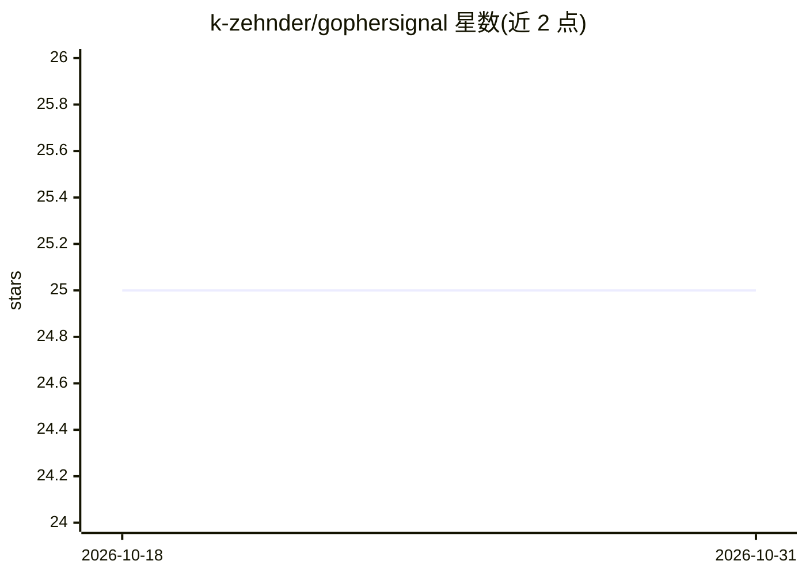

# k-zehnder/gophersignal

⭐ 25 · TypeScript · 推送 2026-09-07 · [GitHub](https://github.com/k-zehnder/gophersignal) · [官网](https://gophersignal.com) · 个人维护

**聚合并 AI 摘要 HackerNews 文章内容的新闻服务**

全栈应用：抓取 HackerNews 文章，使用 AI 生成要点摘要，通过 Next.js 前端展示，并提供 API 与 Swagger 文档。技术栈包含 Go、Rust、MySQL、Nginx，使用 Docker 与 Makefile 编排开发环境。README 给出快速启动流程：克隆仓库、复制 .env 配置、make dev 启动全部服务、make scrape 运行抓取器填充数据库，前端访问 localhost:3000。面向想要本地运行或部署该新闻摘要站点的开发者。

## 筛选速览

| 维度 | 判定 | 备注 |
|---|---|---|
| AI 角色 | `ai-native` | 本体是模型或模型工具 |
| 许可风险 | `none` | — |
| 部署形态 | `None` |  |
| 模型依赖 | — | README 未给出锁定关系 |
| 硬件要求 | — | 无带数字的原话,不猜 |
| 安装摩擦 | `low` | 无编译、无系统依赖或容器化 |
| 成熟度 | — | 结构信号不足 |

## 能力要点

- 抓取 HackerNews 文章并生成 AI 摘要
- Docker + Makefile 一键启动全部服务
- Next.js 前端 + Go API（Swagger 文档）

## 适用场景

- 本地运行获取 HackerNews 文章的 AI 摘要站点
- 部署自托管的新闻聚合摘要服务
- 学习 Go/Rust/NextJS 组成的全栈 AI 应用架构

## 场景标签

`网页抓取` `AI 写作` · 领域:效率与自动化

## 证据(README 行号)

> L1: # GopherSignal
> L30: 4. **Run the Scraper:**
> L40:  - **Frontend:** http://localhost:3000

## 星数曲线

2026-10-18 25 → 2026-10-31 25（+0）

---
*卡片 v1 · prompt 1.4 · 生成 2026-10-27 · 置信度 mid · 依据 README sha `f688175698b8` · [字段定义](../../DATASET.md)*
