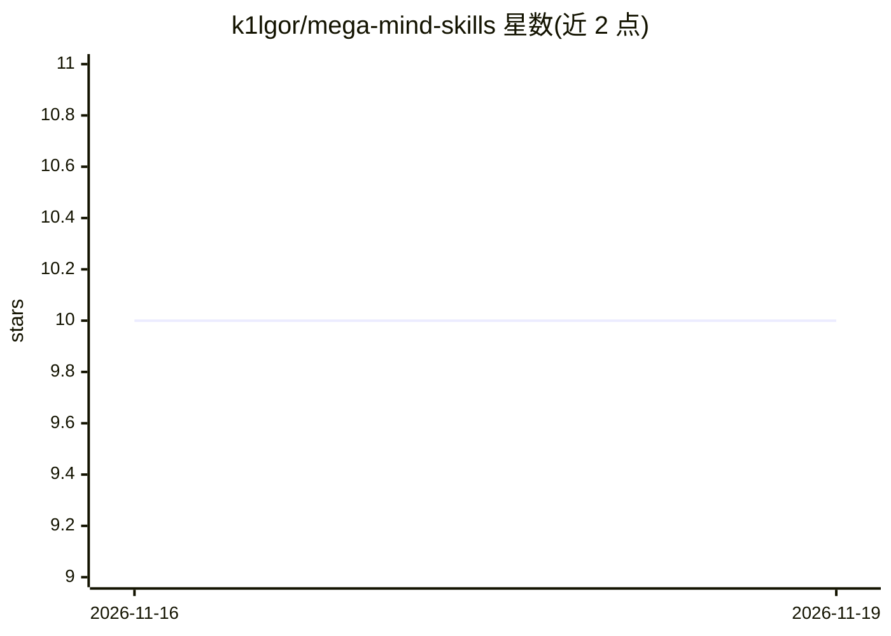

# k1lgor/mega-mind-skills

⭐ 10 · Python · 推送 2026-11-11 · [GitHub](https://github.com/k1lgor/mega-mind-skills) · [官网](https://k1lgor.github.io/mega-mind-skills/) · 个人维护

**为 AI 编码助手提供 53 个技能/11 个 Agent/9 条工作流**

一套面向 AI 编码代理的技能系统：包含 53 个符合 SKILL.md v2.0 规范的技能、11 个 Agent 角色与 9 条覆盖软件开发生命周期的工作流，全部条目在 CI 中做机器校验。提供 pip 包 `mmo`，其中 `mmo route` 为无模型调用的确定性路由器，`mmo init` 可为 Claude、GitHub Copilot 等环境写入 hooks 与配置文件；hooks 依赖需另行安装的 `context-mode` CLI（Node.js 18+）。

## 筛选速览

| 维度 | 判定 | 备注 |
|---|---|---|
| AI 角色 | `ai-ecosystem` | LLM/agent 周边工具 |
| 许可风险 | `none` | — |
| 部署形态 | `self-host` | docker 或自建部署 |
| 模型依赖 | — | README 未给出锁定关系 |
| 硬件要求 | — | 无带数字的原话,不猜 |
| 安装摩擦 | `low` | 无编译、无系统依赖或容器化 |
| 成熟度 | — | 结构信号不足 |

## 能力要点

- 53 个 Gold Standard 技能 + 11 个 Agent 角色 + 9 条工作流，CI 机器校验
- 确定性路由器 `mmo route`，无需模型调用，78/78 短语测试
- pip 包分发，`mmo init` 支持 Claude/Copilot 等多环境配置生成
- 兼容支持 Agent Skills 开放标准的任意编码代理

## 适用场景

- 为我的 AI 编码助手补充覆盖规划、测试、调试、安全的技能集
- 按生命周期工作流组织多代理协作开发
- 控制 AI 会话的上下文与 token 消耗

## 场景标签

`编码 Agent` · 领域:编码与开发

## 证据(README 行号)

> L7: This is a comprehensive skill-based workflow system that combines the disciplined development workflows of Superpowe
> L9: **Compatible with:** Any AI coding agent (Antigravity · GitHub Copilot (VS Code) · Claude Code · Cursor · OpenCode ·

## 星数曲线

2026-11-16 10 → 2026-11-19 10（+0）

---
*卡片 v1 · prompt 1.4 · 生成 2026-11-19 · 置信度 mid · 依据 README sha `7edd92a11d2e` · [字段定义](../../DATASET.md)*
