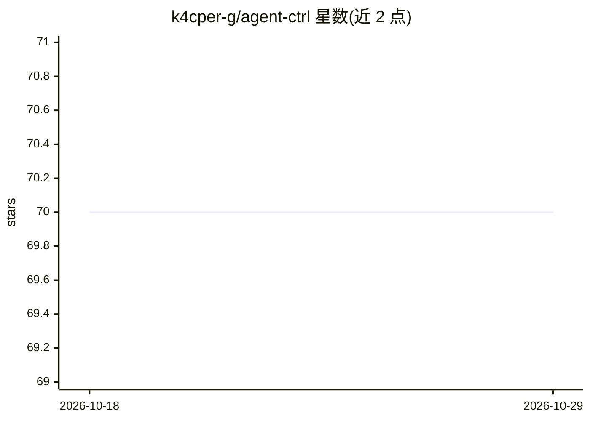

# k4cper-g/agent-ctrl

⭐ 70 · Rust · Apache-2.0 · 推送 2026-08-01 · [GitHub](https://github.com/k4cper-g/agent-ctrl) · 个人维护

**供 AI agent 驱动原生桌面 UI 的 Rust 命令行工具**

Rust 编写的桌面自动化 CLI，供 AI agent 以命令方式操作原生 UI：通过 UIA（Windows）、AX（macOS）、AT-SPI（Linux）读取无障碍树生成快照，以 @eN/@sN 引用执行点击、输入、选择、等待、窗口切换等动作，支持多会话、批量步骤与 --json 结构化输出。浏览器自动化明确排除在范围外，由同作者的 agent-browser 承担，两者设计为在同一 agent 循环中组合。预编译二进制覆盖 Windows x64 与 macOS 双架构；Linux 仅有只读快照路径，动作词汇表及 Android/iOS 未实现。提供 npm 分发与 TypeScript 客户端。

## 筛选速览

| 维度 | 判定 | 备注 |
|---|---|---|
| AI 角色 | `ai-ecosystem` | LLM/agent 周边工具 |
| 许可风险 | `permissive` | Apache-2.0 |
| 部署形态 | `desktop` | 安装包/桌面程序 |
| 模型依赖 | — | README 未给出锁定关系 |
| 硬件要求 | — | 无带数字的原话,不猜 |
| 安装摩擦 | `low` | 无编译、无系统依赖或容器化 |
| 成熟度 | — | 结构信号不足 |

## 能力要点

- snapshot 一次生成 @eN/@sN 引用树，后续按引用执行动作
- 跨 Windows/macOS/Linux 三个无障碍表面（Linux 目前仅只读路径）
- batch 单会话顺序执行步骤，多数命令支持 --json 结构化输出
- npm 包下载平台原生二进制并校验 SHA-256

## 适用场景

- 让 AI agent 操作本机桌面应用的按钮、输入框与对话框
- 在 agent 循环中与 agent-browser 组合，同时覆盖原生 UI 与浏览器
- 用 CLI/JSON 输出编写可脚本化的桌面自动化流水线

## 场景标签

`GUI 自动化` · 领域:效率与自动化

## 证据(README 行号)

> L3:  Desktop automation CLI for AI agents. Fast native Rust CLI.
> L5: > **Browser automation is out of scope.** agent-ctrl drives native UI; for Chromium-via-CDP use the sibling agent-br

## 星数曲线

2026-10-18 70 → 2026-10-29 70（+0）

---
*卡片 v1 · prompt 1.4 · 生成 2026-10-24 · 置信度 mid · 依据 README sha `a59dd5244d00` · [字段定义](../../DATASET.md)*
