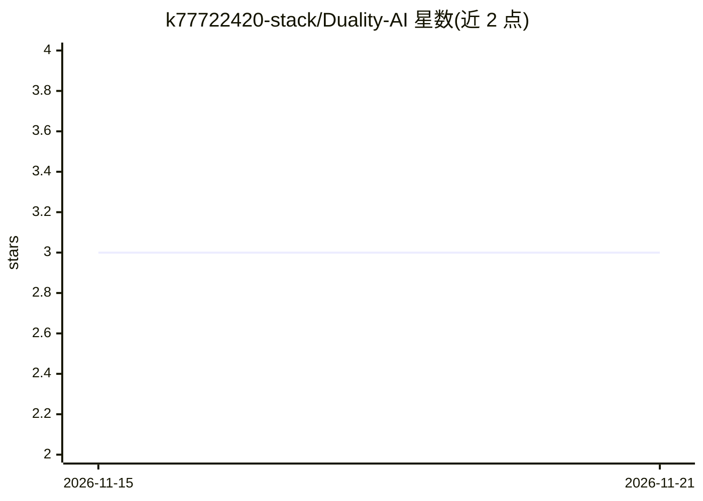

# k77722420-stack/Duality-AI

⭐ 3 · Python · MIT · 推送 2026-11-15 · [GitHub](https://github.com/k77722420-stack/Duality-AI) · [官网](https://diverseinnovationsd.com) · 个人维护

**三层 AI 架构的理论设计研究与可运行结构演示**

由 Kenneth Lee Blum Jr 提出的三层治理架构概念：推理层（双半球+道德门控）、防护层（门守机器人、沙箱、尺寸法则）、记忆层（哈希链溯源、衰减遗忘、道德条款豁免）。项目明确定位为理论设计与研究原型而非可用 AI 产品，代码仅为纯 Python 标准库的结构骨架，不做学习、不调用模型、不联网；配有三篇论文、已知弱点清单、宽限审计轨迹等设计文档，MIT 许可，欢迎贡献。

## 筛选速览

| 维度 | 判定 | 备注 |
|---|---|---|
| AI 角色 | `ai-knowledge` | 知识聚合/清单类 |
| 许可风险 | `permissive` | MIT |
| 部署形态 | `None` |  |
| 模型依赖 | — | README 未给出锁定关系 |
| 硬件要求 | — | 无带数字的原话,不猜 |
| 安装摩擦 | `low` | 无编译、无系统依赖或容器化 |
| 成熟度 | `idea` | |

## 能力要点

- 三层架构论文集：THESIS.md / THESIS-LAYER-2.md / THESIS-LAYER-3.md 及合篇
- 道德条款以 JSON 数据形式存储，可读取、辩论、修改而不动代码
- 纯 Python 3 标准库实现的结构骨架与三个演示脚本及测试套件
- 公开维护的 KNOWN-LIMITATIONS.md（failure museum）与握手开放问题文档

## 适用场景

- 研究分层治理 AI 架构的设计思路
- 检验道德门控与宽限审计机制的记录方式
- 查看哈希链记忆与衰减遗忘策略的可运行演示

## 场景标签

 · 领域:AI 安全/架构研究

## 证据(README 行号)

> L3: > **What this is — please read first:** The Duality AI is a **theoretical architecture**: a design proposal and rese
> L26: > **What this is, stated up front:** a theoretical design study. It is
> L54: |THESIS.md — **Layer One: The Core**|The original thesis: two reasoning hemispheres, the weighing hub, and the mora

## 星数曲线

2026-11-15 3 → 2026-11-21 3（+0）

---
*卡片 v1 · prompt 1.4 · 生成 2026-11-21 · 置信度 high · 依据 README sha `c98e1b6d0167` · [字段定义](../../DATASET.md)*
