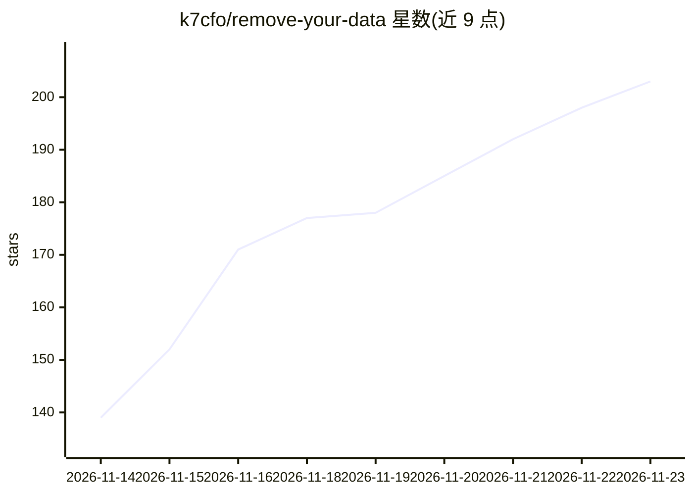

# k7cfo/remove-your-data

⭐ 203 · Python · Apache-2.0 · 推送 2026-11-14 · [GitHub](https://github.com/k7cfo/remove-your-data) · [官网](https://github.com/k7cfo/remove-your-data) · 个人维护

**让 AI agent 免费替你向数据经纪商提交删除请求的技能仓库**

一个供编码型 AI agent（Grok Bot、Claude Code、Codex、Cursor 等）使用的 agent skill：把仓库 URL 粘贴给 agent 即可启动。agent 以用户本人邮箱提交 people-search 站点与数据经纪商的第一方退出请求，处理验证邮件往来，追踪州隐私法时限并催办过期请求，加州居民先走 DROP 流程；附带 Python 脚本（ryd.py）维护本地 SQLite 日志、生成聊天内状态卡片、可选 SerpApi 残留扫描与 localhost 只读面板。与付费删除服务的对比表为用户自述结果，非法律建议。

## 筛选速览

| 维度 | 判定 | 备注 |
|---|---|---|
| AI 角色 | `ai-native` | 本体是模型或模型工具 |
| 许可风险 | `permissive` | Apache-2.0 |
| 部署形态 | `None` |  |
| 模型依赖 | — | README 未给出锁定关系 |
| 硬件要求 | — | 无带数字的原话,不猜 |
| 安装摩擦 | `low` | 无编译、无系统依赖或容器化 |
| 成熟度 | — | 结构信号不足 |

## 能力要点

- 以用户本人邮箱提交退出请求并自动处理验证码与经纪商回复
- 本地 SQLite 日志记录每个请求，数据留在本机、无遥测
- 可选 SerpApi 残留扫描（免费档、月度上限、watch-only）
- ryd.py 提供 init/recap/report/serve 等命令与 PNG 状态卡片

## 适用场景

- 我想不花钱把自己从 Whitepages、Spokeo 等 people-search 站点删掉
- 我希望 AI agent 替我跟进验证邮件和过期请求
- 我想为全家成员分别提交退出请求并保留完整记录

## 场景标签

 · 领域:隐私保护/个人数据合规

## 证据(README 行号)

> L16: An agent skill that removes a person's listings from people-search sites and data brokers without paying a deletion
> L26: **Any other AI agent:** paste this link into Claude Code, Codex, Cursor, Hermes, OpenClaw, or any agent that can re

## 星数曲线

2026-11-14 139 → 2026-11-23 203（+64）

---
*卡片 v1 · prompt 1.4 · 生成 2026-11-17 · 置信度 high · 依据 README sha `9744b309bea9` · [字段定义](../../DATASET.md)*
