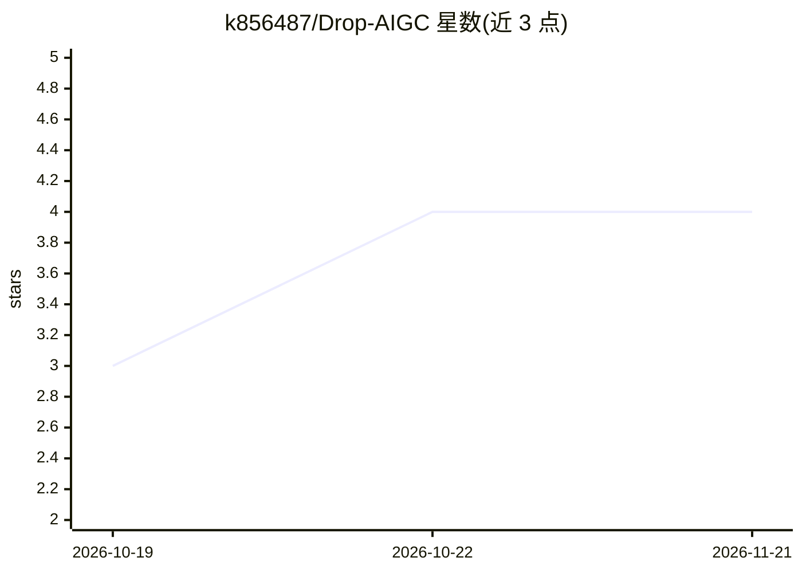

# k856487/Drop-AIGC

⭐ 4 · Python · MIT · 推送 2026-10-23 · [GitHub](https://github.com/k856487/Drop-AIGC) · [官网](https://huggingface.co/k86574/Drop-AIGC) · 个人维护 · 中文 README

**本地改写中文文本以降低 AI 率的工具**

读取 GGUF 格式的本地模型权重，将中文学术句子改写为更接近人工撰写的表述，改写中保留术语、数字与原意；仅支持中文。运行方式：从 Hugging Face 下载约 3.1 GB 的 F16 模型，经 Python venv 安装依赖后以 app/server.py 启动本地 Web 服务（端口 8780）。推理依赖 llama.cpp 的 llama-cli/llama-server，显卡可选；若本机已有 llama-server 服务，可通过环境变量复用而无需重复加载权重。

## 筛选速览

| 维度 | 判定 | 备注 |
|---|---|---|
| AI 角色 | `ai-native` | 本体是模型或模型工具 |
| 许可风险 | `permissive` | MIT |
| 部署形态 | `library` | 以包/库形式分发 |
| 模型依赖 | local-ok | 支持本地模型 |
| 硬件要求 | — | 无带数字的原话,不猜 |
| 安装摩擦 | `low` | 无编译、无系统依赖或容器化 |
| 成熟度 | — | 结构信号不足 |

## 能力要点

- 本地改写中文文本，保留术语、数字与原意
- 模型为 GGUF F16 格式，约 3.1 GB，从 Hugging Face 下载
- 基于 llama.cpp 推理，显卡可选
- 支持复用已有 llama-server 服务地址

## 适用场景

- 将中文学术句子改写成更接近人工撰写的表述
- 在本地离线环境处理中文文本改写
- 已有 llama.cpp 服务时复用推理后端

## 场景标签

`AI 写作` · 领域:内容生成

## 证据(README 行号)

> L3: 降低中文文本 AI 率的本地改写工具。将中文学术句子改写成更接近人工撰写的表述，保留术语、数字与原意。
> L27: |推理|llama.cpp 的 `llama-cli`。已有 `llama-server` 时可复用，见下方|

## 星数曲线

2026-10-19 3 → 2026-11-21 4（+1）

---
*卡片 v1 · prompt 1.4 · 生成 2026-11-21 · 置信度 high · 依据 README sha `f8c17d44226c` · [字段定义](../../DATASET.md)*
