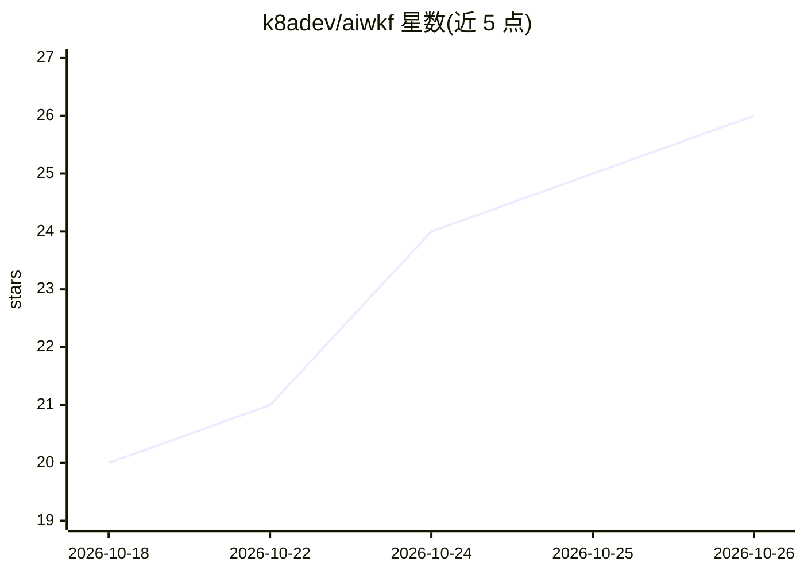

# k8adev/aiwkf

⭐ 26 · Shell · 推送 2026-10-23 · [GitHub](https://github.com/k8adev/aiwkf) · 个人维护

**个人维护的 Claude Code 代理/技能/插件集合，兼容 Codex**

作者 Keit（18 年程序员）日常工作所用 AI 编码资产的活仓库：收录五个按判断力需求（而非职位）组织的小型代理团队、编排技能及各类插件与技能，主要为 Claude Code 构建，同时兼容 Codex。仓库随作者工作方式持续演化，使用者可随之跟进自己的 AI 日常流程。README 提供插件（agents 等）章节说明，属于个人技能/资产策展而非框架或产品。

## 筛选速览

| 维度 | 判定 | 备注 |
|---|---|---|
| AI 角色 | `ai-knowledge` | 知识聚合/清单类 |
| 许可风险 | `none` | — |
| 部署形态 | `None` |  |
| 模型依赖 | — | README 未给出锁定关系 |
| 硬件要求 | — | 无带数字的原话,不猜 |
| 安装摩擦 | `low` | 无编译、无系统依赖或容器化 |
| 成熟度 | — | 结构信号不足 |

## 能力要点

- 五个按判断力需求组织的代理及 orchestrate 编排技能
- 主要为 Claude Code 构建，同时兼容 Codex
- 活仓库，随作者工作方式持续更新

## 适用场景

- 为 Claude Code 补充现成的代理与技能资产
- 在 Codex 中复用同一套代理/技能
- 参考他人 AI 配对编程的工作流组织方式

## 场景标签

`编码 Agent` `精选清单` · 领域:编码与开发

## 证据(README 行号)

> L9: This is where I keep the agents, skills and everything I use to speed up, with AI, the work I already do. It's built
> L15: **agents** is a small team of five agents, organized by how much judgment the work needs, not by job titles like a 

## 星数曲线

2026-10-18 20 → 2026-10-26 26（+6）

---
*卡片 v1 · prompt 1.4 · 生成 2026-10-26 · 置信度 mid · 依据 README sha `d52d02208f88` · [字段定义](../../DATASET.md)*
