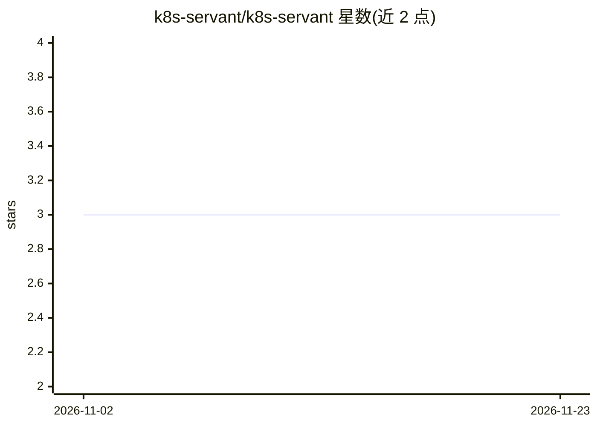

# k8s-servant/k8s-servant

⭐ 3 · Python · Apache-2.0 · 推送 2026-11-20 · [GitHub](https://github.com/k8s-servant/k8s-servant) · [官网](https://k8s-servant.dev) · 组织维护

**只读 Kubernetes AI SRE：诊断集群问题并给出证据与建议**

以只读方式接入 Kubernetes 集群的 AI 诊断代理：回答集群健康问题、按计划执行健康检查并区分 new/still open/resolved、工作日早晨推送晨报，输出到终端与 MS Teams。通过 kubernetes-mcp-server（只读）、受保护的 kubectl、Prometheus/Alertmanager 读取集群，模型来源由 LLM_PROVIDER 指定（Foundry/OpenAI/Anthropic/Ollama/OpenAI 兼容端点）。绝不修改集群，只描述修复建议；声明处于早期阶段，结论可能出错需人工核验。

## 筛选速览

| 维度 | 判定 | 备注 |
|---|---|---|
| AI 角色 | `ai-native` | 本体是模型或模型工具 |
| 许可风险 | `permissive` | Apache-2.0 |
| 部署形态 | `library` | 以包/库形式分发 |
| 模型依赖 | local-ok | 支持本地模型 |
| 硬件要求 | — | 无带数字的原话,不猜 |
| 安装摩擦 | `low` | 无编译、无系统依赖或容器化 |
| 成熟度 | `idea` | |

## 能力要点

- 只读约束：不更改集群，每条结论附证据（对象、字段、事件、时间）
- 支持多模型后端：Microsoft Foundry、OpenAI、Anthropic、Ollama 及 OpenAI 兼容服务器
- 健康检查记忆对比（new/still open/resolved），无变化时跳过模型调用
- 通过 Markdown 的环境描述、集群笔记与 SKILL.md 技能文件定制平台知识

## 适用场景

- 运维人员快速排查 pod pending、工作负载不健康等集群问题
- 定时巡检集群并通过 Teams 接收问题新增/解决通知
- 用自托管 Ollama 模型在内网环境运行集群诊断

## 场景标签

 · 领域:云原生/运维

## 证据(README 行号)

> L13: A **read-only AI SRE** for Kubernetes clusters. It looks at a cluster the way an
> L36: - **An assistant you can ask.** "Are there unhealthy pods?", "why is X pending?", "is
> L103: model asks for read-only tools (summary tools first, then kubernetes-mcp-server and a

## 星数曲线

2026-11-02 3 → 2026-11-23 3（+0）

---
*卡片 v1 · prompt 1.4 · 生成 2026-11-21 · 置信度 high · 依据 README sha `0ca712c91747` · [字段定义](../../DATASET.md)*
