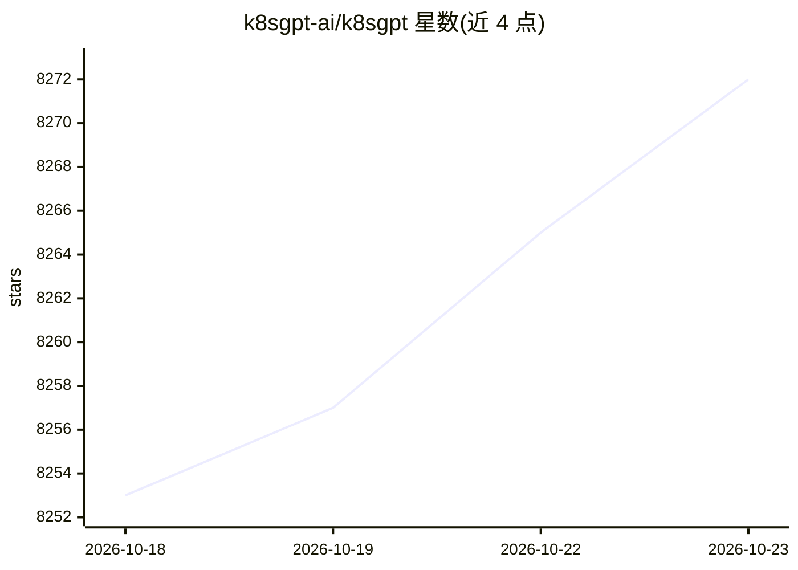

# k8sgpt-ai/k8sgpt

⭐ 8,272 · Go · Apache-2.0 · 推送 2026-10-22 · [GitHub](https://github.com/k8sgpt-ai/k8sgpt) · [官网](http://k8sgpt.ai) · 组织维护

**用内置 SRE 分析器扫描 Kubernetes 集群并用 AI 解释问题**

Go 编写的 CLI 工具，用内置 SRE 经验编码的分析器扫描 Kubernetes 集群、诊断并分诊问题，可用 --explain 将结果交给 LLM 后端（OpenAI/Azure/Cohere/Amazon Bedrock/Google Gemini 及本地模型）生成通俗解释。支持过滤器管理、匿名化、JSON 输出、serve 模式与 MCP 服务器（默认 8089 端口）接入 Claude Desktop 等 MCP 客户端，另有 operator 形式在集群内持续监控。安装覆盖 brew、RPM/DEB/APK 包与 Windows 二进制。

## 筛选速览

| 维度 | 判定 | 备注 |
|---|---|---|
| AI 角色 | `ai-enhanced` | 去掉 AI 部分产品仍成立 |
| 许可风险 | `permissive` | Apache-2.0 |
| 部署形态 | `desktop` | 安装包/桌面程序 |
| 模型依赖 | locked-api |  |
| 硬件要求 | — | 无带数字的原话,不猜 |
| 安装摩擦 | `medium` | 含编译或系统依赖之一 |
| 成熟度 | — | 结构信号不足 |

## 能力要点

- 30+ 个内置 SRE 分析器（Pod/Service/Ingress/Node 等）扫描诊断集群
- 多 LLM 后端解释分析结果，含 LiteLLM 代理路由 100+ provider
- 敏感数据在发送 AI 后端前匿名化，返回后可还原
- MCP 服务器模式接入 Claude Desktop 等 MCP 兼容客户端

## 适用场景

- 排查集群故障时快速定位问题并获得 AI 解释与修复建议
- 通过 Claude Desktop 对话查询集群健康状态
- 以 operator 形式持续监控集群并接入 Prometheus/Alertmanager

## 场景标签

 · 领域:DevOps/Kubernetes 运维

## 证据(README 行号)

> L13: `k8sgpt` is a tool for scanning your Kubernetes clusters, diagnosing, and triaging issues in simple English.
> L15: It has SRE experience codified into its analyzers and helps to pull out the most relevant information to enrich it 
> L17: _Out of the box integration with OpenAI, Azure, Cohere, Amazon Bedrock, Google Gemini and local models._

## 星数曲线

2026-10-18 8,253 → 2026-10-23 8,272（+19）

---
*卡片 v1 · prompt 1.4 · 生成 2026-10-20 · 置信度 high · 依据 README sha `331dc2007a43` · [字段定义](../../DATASET.md)*
