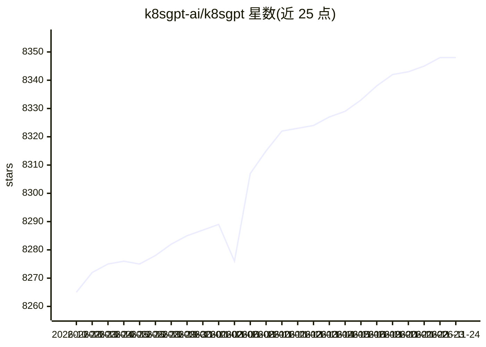

# k8sgpt-ai/k8sgpt

⭐ 8,348 · Go · Apache-2.0 · 推送 2026-11-23 · [GitHub](https://github.com/k8sgpt-ai/k8sgpt) · [官网](http://k8sgpt.ai) · 组织维护

**扫描 Kubernetes 集群并用 LLM 解释诊断结果的 CLI/Operator**

面向 Kubernetes 集群的扫描与诊断工具：内置 14 个默认启用的分析器（Pod、Deployment、Service、Ingress、Webhook 等）及 20 余个可选分析器，对集群问题做分诊；通过 --explain 标志将分析结果交给所选 LLM 后端生成解释，并可用 --with-doc 附带官方文档、用 --anonymize 在发送前对敏感对象名做掩码与还原。提供 CLI（brew/rpm/deb/apk/二进制）与 k8sgpt-operator 两种部署方式，另可通过 gRPC serve 模式或 MCP 服务器供 Claude Desktop 等 MCP 客户端调用。使用 AI 解释功能需自行配置 API key。

## 筛选速览

| 维度 | 判定 | 备注 |
|---|---|---|
| AI 角色 | `ai-enhanced` | 去掉 AI 部分产品仍成立 |
| 许可风险 | `permissive` | Apache-2.0 |
| 部署形态 | `desktop` | 安装包/桌面程序 |
| 模型依赖 | locked-api |  |
| 硬件要求 | — | 无带数字的原话,不猜 |
| 安装摩擦 | `medium` | 含编译或系统依赖之一 |
| 成熟度 | — | 结构信号不足 |

## 能力要点

- 内置 14 个默认分析器 + 20 余个可选分析器（含 Karpenter NodeClaim/NodePool）
- 多 LLM 后端接入：OpenAI、Azure、Cohere、Amazon Bedrock、Gemini、本地模型、LiteLLM/GPT2Giga 代理
- --anonymize 在发送至 AI 后端前对敏感数据掩码并可还原
- MCP 服务器模式（默认端口 8089）供 Claude Desktop 等 MCP 客户端集成

## 适用场景

- 排查集群中 Pod、Service、Ingress 等资源的异常
- 需要自然语言解释的诊断结果辅助值班处理
- 通过 Operator 做集群持续监控并对接 Prometheus/Alertmanager
- 在 Claude Desktop 中通过 MCP 直接分析集群

## 场景标签

 · 领域:DevOps/云原生运维

## 证据(README 行号)

> L15: `k8sgpt` is a tool for scanning your Kubernetes clusters, diagnosing, and triaging issues in simple English.
> L17: It has SRE experience codified into its analyzers and helps to pull out the most relevant information to enrich it 
> L401: K8sGPT uses the chosen LLM, generative AI provider when you want to explain the analysis results using --explain f

## 星数曲线

2026-10-22 8,265 → 2026-11-24 8,348（+83）

---
*卡片 v1 · prompt 1.4 · 生成 2026-11-22 · 置信度 high · 依据 README sha `aa92c30081a1` · [字段定义](../../DATASET.md)*
