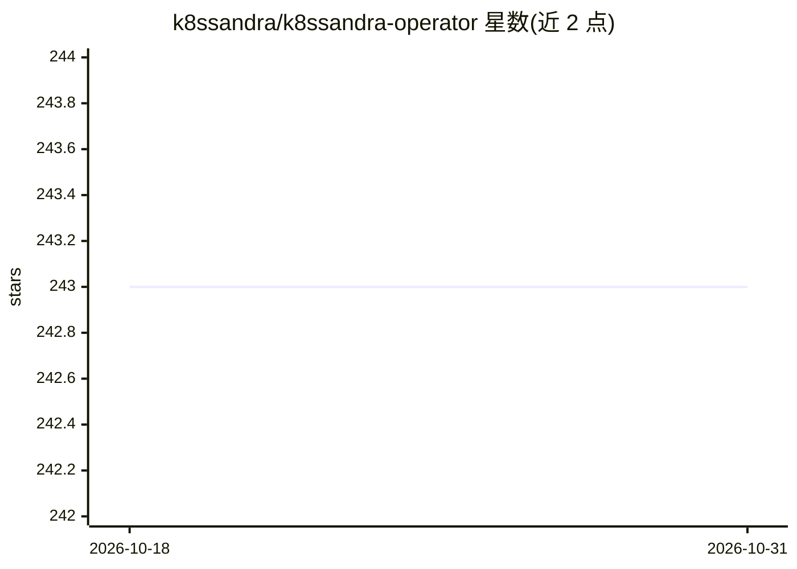

# k8ssandra/k8ssandra-operator

⭐ 243 · Go · Apache-2.0 · 推送 2026-10-30 · [GitHub](https://github.com/k8ssandra/k8ssandra-operator) · [官网](https://k8ssandra.io/) · 组织维护

**在 Kubernetes 上部署管理多集群 Apache Cassandra/DSE 的 Operator**

K8ssandra Operator 是管理 Apache Cassandra 与 DataStax Enterprise（DSE）的 Kubernetes operator：通过单一控制平面集群管理跨多个 Kubernetes 集群、多区域的 Cassandra 数据中心，实现地理复制部署；集成 Reaper 做定期修复、Medusa 做 S3/GCS/Azure 备份恢复、基于 Vector 的指标管道输出到 Prometheus 等系统；支持 CDC 与全查询日志的清单式配置。DSE 提供面向生成式 AI 应用的向量搜索能力。面向使用 Kubernetes 运行 Cassandra 的运维/开发人员。

## 筛选速览

| 维度 | 判定 | 备注 |
|---|---|---|
| AI 角色 | `ai-ecosystem` | LLM/agent 周边工具 |
| 许可风险 | `permissive` | Apache-2.0 |
| 部署形态 | `None` |  |
| 模型依赖 | — | README 未给出锁定关系 |
| 硬件要求 | — | 无带数字的原话,不猜 |
| 安装摩擦 | `low` | 无编译、无系统依赖或容器化 |
| 成熟度 | — | 结构信号不足 |

## 能力要点

- 单一控制平面跨多 Kubernetes 集群管理 Cassandra 数据中心
- 集成 Reaper 定期修复、Medusa 云存储备份恢复
- 基于 Vector 的指标管道（Prometheus/Mimir/Kafka 等目标）
- CDC 与全查询日志可经 Kubernetes 清单配置

## 适用场景

- 跨区域多集群部署 Cassandra 实现地理复制
- 用声明式清单管理 Cassandra 的监控、修复与备份
- 为需要向量搜索（DSE）的生成式 AI 应用运维 Cassandra 底座

## 场景标签

 · 领域:云原生/数据库基础设施

## 证据(README 行号)

> L7: k8ssandra-operator is a turnkey solution to manage Apache Cassandra and DSE on Kubernetes. Apache Cassandra is the p
> L9: DataStax Enterprise, DSE, is the DataStax distribution of Apache Cassandra, offering additional features such as adv

## 星数曲线

2026-10-18 243 → 2026-10-31 243（+0）

---
*卡片 v1 · prompt 1.4 · 生成 2026-10-22 · 置信度 mid · 依据 README sha `368736a391dc` · [字段定义](../../DATASET.md)*
