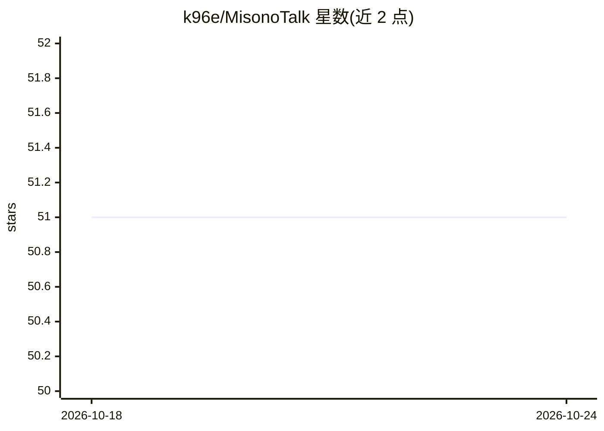

# k96e/MisonoTalk

⭐ 51 · Dart · MIT · 推送 2026-09-27 · [GitHub](https://github.com/k96e/MisonoTalk) · 个人维护 · 中文 README

**碧蓝档案 MomoTalk 风格的 LLM 聊天客户端**

基于 Flutter 开发的移动端 LLM 聊天应用，界面模仿碧蓝档案的 MomoTalk 对话样式。用户在 Settings 中配置模型 API（base_url、api key、model）后即可对话；支持导出包含对话与密钥的备份文件、通过 WebDAV 备份同步（Commit a05bb73 之后支持端到端加密，附外部解密脚本）。另支持通过自建 HuggingFace Space 作为 AI 绘画 API。自述为自用项目，未做提示词攻击防范与联网搜索。

## 筛选速览

| 维度 | 判定 | 备注 |
|---|---|---|
| AI 角色 | `ai-native` | 本体是模型或模型工具 |
| 许可风险 | `permissive` | MIT |
| 部署形态 | `None` |  |
| 模型依赖 | — | README 未给出锁定关系 |
| 硬件要求 | — | 无带数字的原话,不猜 |
| 安装摩擦 | `low` | 无编译、无系统依赖或容器化 |
| 成熟度 | `idea` | |

## 能力要点

- MomoTalk 风格的 LLM 聊天界面，配置 OpenAI 兼容式 API 使用
- WebDAV 备份同步支持端到端加密，附解密脚本 scripts/decrypt.py
- AI 绘画通过用户自建 HuggingFace Space 作为 API
- 预设提示词位于 assets/prompt.txt，可自行覆盖

## 适用场景

- 用 MomoTalk 风格界面与 LLM 角色扮演对话
- 在多设备间通过 WebDAV 加密同步聊天记录
- 接入自建 HuggingFace Space 使用 AI 绘画

## 场景标签

`聊天机器人` `图像生成` · 领域:对话与助手

## 证据(README 行号)

> L11:  点击右上角×， 选择Settings，配置模型api
> L24:  使用这个HuggingFace Space作为api，你需要Duplicate this Space，获取自己的hf space url

## 星数曲线

2026-10-18 51 → 2026-10-24 51（+0）

---
*卡片 v1 · prompt 1.4 · 生成 2026-10-24 · 置信度 high · 依据 README sha `0207ee0dd04a` · [字段定义](../../DATASET.md)*
