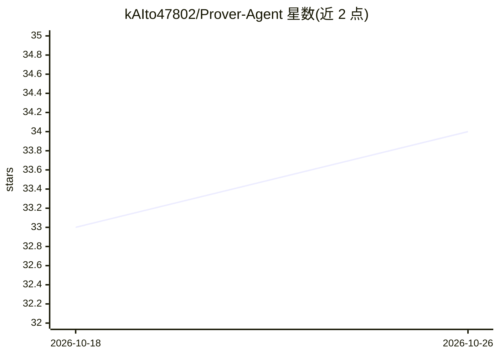

# kAIto47802/Prover-Agent

⭐ 34 · Python · MIT · 推送 2025-11-01 · [GitHub](https://github.com/kAIto47802/Prover-Agent) · 组织维护

**结合 LLM 与 Lean 的自动定理证明 Agent 框架**

用于形式化数学定理证明的 AI agent 框架：协调非正式推理 LLM、形式化证明模型与 Lean 4 反馈，并生成辅助引理（包括特例与从假设推导的事实）以帮助发现证明策略。作者报告其在 MiniF2F 基准上达到 88.1% 成功率，并有 arXiv 论文与 ICML 2025 workshop 海报。安装需克隆仓库、配置 Lean 4 工作区、pip 安装依赖、准备 MiniF2F 数据集并启动 vLLM LLM 服务；示例配置面向 8×40GB A100 GPU。面向定理证明与形式验证方向的研究者。

## 筛选速览

| 维度 | 判定 | 备注 |
|---|---|---|
| AI 角色 | `ai-native` | 本体是模型或模型工具 |
| 许可风险 | `permissive` | MIT |
| 部署形态 | `library` | 以包/库形式分发 |
| 模型依赖 | local-ok | 支持本地模型 |
| 硬件要求 | — | 无带数字的原话,不猜 |
| 安装摩擦 | `low` | 无编译、无系统依赖或容器化 |
| 成熟度 | — | 结构信号不足 |

## 能力要点

- 协调非正式推理 LLM、形式证明模型与 Lean 反馈的 agent 工作流
- 生成辅助引理（子目标、特例、假设派生事实）辅助证明发现
- MiniF2F 基准 88.1% 成功率（论文报告）
- 提供 Hugging Face 上的预处理 MiniF2F 数据集

## 适用场景

- 在 MiniF2F 基准上运行自动定理证明实验
- 研究生成辅助引理对形式化证明的作用
- 复现论文中的定理证明结果

## 场景标签

`Agent 框架` `科研工具` · 领域:Agent 开发

## 证据(README 行号)

> L15:  We present Prover Agent, a novel AI agent for automated theorem proving that integrates large language models (LLM
> L85: Modify `serve.sh` (for launching the vLLM server) and `server_config.yml` (for the LiteLLM proxy) according to your

## 星数曲线

2026-10-18 33 → 2026-10-26 34（+1）

---
*卡片 v1 · prompt 1.4 · 生成 2026-10-25 · 置信度 high · 依据 README sha `7d83aa707f0d` · [字段定义](../../DATASET.md)*
