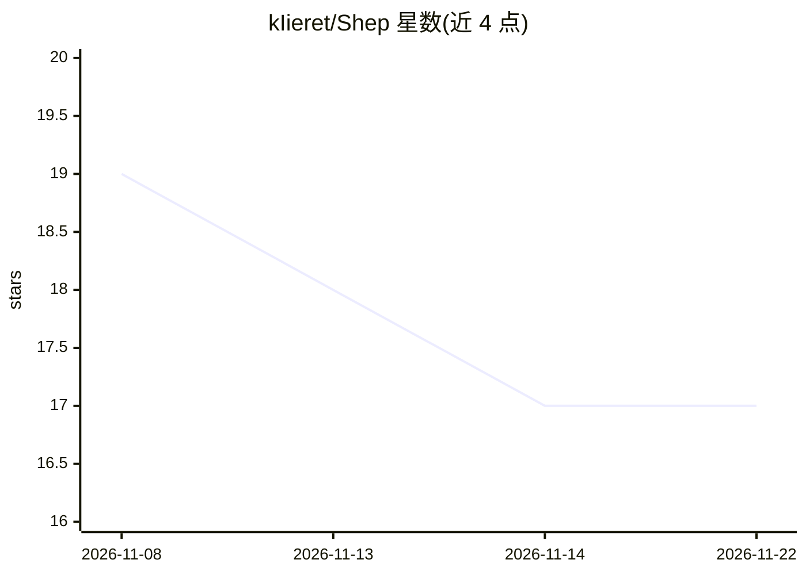

# kIieret/Shep

⭐ 17 · TypeScript · 推送 2026-11-01 · [GitHub](https://github.com/kIieret/Shep) · 个人维护

**编排多个并行 AI 编程 agent 的本地编排器，自动开 PR**

面向开发者的命令行与 Web 编排工具：让 Claude Code、Codex CLI、Gemini CLI 等多种 agent CLI 各自在隔离的 git worktree 中并行实现功能，自动完成 commit、push、CI 监听（失败自动修复重试 3 次）与 draft PR 创建，合并需人工批准。支持规格驱动流水线（YAML 需求/计划与审批门）与快速模式，可在每个功能粒度切换 agent 与模型。数据本地存储于 ~/.shep/（SQLite），默认开启匿名使用遥测（可关闭）。

## 筛选速览

| 维度 | 判定 | 备注 |
|---|---|---|
| AI 角色 | `ai-ecosystem` | LLM/agent 周边工具 |
| 许可风险 | `none` | — |
| 部署形态 | `library` | 以包/库形式分发 |
| 模型依赖 | local-ok | 支持本地模型 |
| 硬件要求 | — | 无带数字的原话,不猜 |
| 安装摩擦 | `low` | 无编译、无系统依赖或容器化 |
| 成熟度 | — | 结构信号不足 |

## 能力要点

- 每个功能在独立 git worktree 中运行，主工作目录不被修改
- CI 失败时 agent 读日志自动修复（默认重试 3 次，可配置）
- 内置 12 种 agent 后端：Claude Code/Codex/Gemini CLI/Ollama/OpenRouter 等，按功能粒度切换
- localhost:4050 Web 控制台与 CLI 功能等价，含实时状态图与 diff 审查

## 适用场景

- 并行开发多个功能，由多个 AI agent 在隔离分支同时写代码
- 从一句话描述走完 spec→实现→PR 的自动化流水线
- 让 agent 监听 CI 并自动修复失败的构建

## 场景标签

`编码 Agent` `多智能体` · 领域:Agent 开发

## 证据(README 行号)

> L13: Shep is the open-source orchestrator for the autonomous development cycle. It runs parallel AI agents — Claude Code
> L71: |Agent|Binary|Support|
> L84: |Demo (`dev`)|—|Built-in mock — no agent binary required|

## 星数曲线

2026-11-08 19 → 2026-11-22 17（-2）

---
*卡片 v1 · prompt 1.4 · 生成 2026-11-18 · 置信度 high · 依据 README sha `8eea6a13bc27` · [字段定义](../../DATASET.md)*
