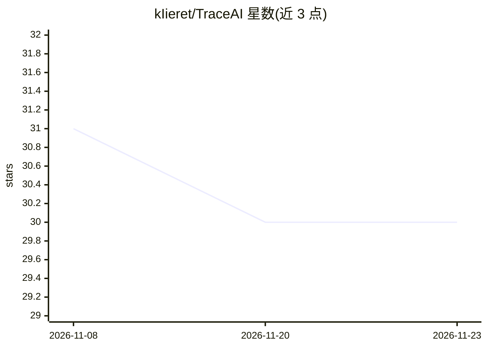

# kIieret/TraceAI

⭐ 30 · Python · 推送 2026-11-22 · [GitHub](https://github.com/kIieret/TraceAI) · 组织维护

**基于 OpenTelemetry 的 AI 应用可观测性工具，追踪 LLM 调用与 agent 决策**

traceAI 是面向 AI 应用的开源可观测性插桩库：将每次 LLM 调用、prompt、token 计数、检索步骤与 agent 决策捕获为结构化 OpenTelemetry 追踪数据，发送到任何 OTel 兼容后端（Datadog、Grafana、Jaeger 等）。提供 Python、TypeScript、Java、C# 四种语言的 API，覆盖 50+ AI 框架的接入插桩（LLM 提供商、agent 框架、向量数据库等），接入方式为在现有代码中添加约 3 行注册代码，并支持自定义 TracerProvider 与 OTLP 导出器。由 Future AGI 团队维护。

## 筛选速览

| 维度 | 判定 | 备注 |
|---|---|---|
| AI 角色 | `ai-ecosystem` | LLM/agent 周边工具 |
| 许可风险 | `none` | — |
| 部署形态 | `library` | 以包/库形式分发 |
| 模型依赖 | local-ok | 支持本地模型 |
| 硬件要求 | — | 无带数字的原话,不猜 |
| 安装摩擦 | `medium` | 含编译或系统依赖之一 |
| 成熟度 | — | 结构信号不足 |

## 能力要点

- 50+ AI 框架插桩，覆盖 Python/TypeScript/Java/C# 四种语言
- OpenTelemetry 原生，追踪数据可发送到任何 OTel 兼容后端
- 捕获 prompt、补全、token 用量、模型参数、工具调用、流式 chunk、错误与延迟
- 接入方式为在现有代码添加约 3 行注册代码，无需重构

## 适用场景

- 排查 AI agent 回答出错时具体是哪个检索、工具或 prompt 环节出问题
- 在 Datadog/Grafana/Jaeger 等现有后端中查看 LLM 调用与 token 消耗
- 为生产环境的 LLM 应用补充低开销的调用级追踪

## 场景标签

`LLM 可观测性` · 领域:评测与运维

## 证据(README 行号)

> L11: **Open-source observability for AI applications - trace every LLM call, prompt, token, retrieval step, and agent de
> L13: Built on OpenTelemetry, traceAI sends structured traces to any OTel-compatible backend (Datadog, Grafana, Jaeger, F
> L25: - **Drop-in instrumentation** for 50+ AI frameworks across 4 languages

## 星数曲线

2026-11-08 31 → 2026-11-23 30（-1）

---
*卡片 v1 · prompt 1.4 · 生成 2026-11-18 · 置信度 high · 依据 README sha `f140982cf6e9` · [字段定义](../../DATASET.md)*
