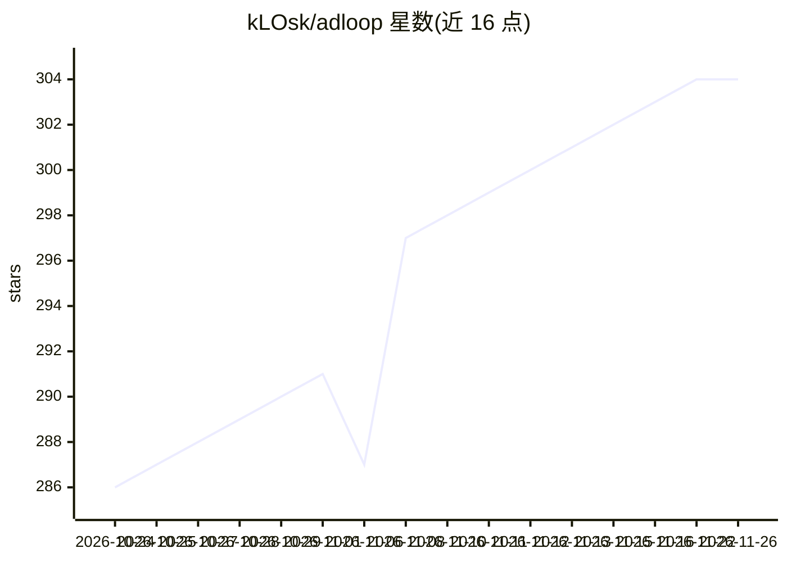

# kLOsk/adloop

⭐ 304 · Python · MIT · 推送 2026-11-25 · [GitHub](https://github.com/kLOsk/adloop) · [官网](https://getadloop.com) · 个人维护

**给 AI 助手接入 Google Ads/GA4 读写能力的 MCP 服务器**

MCP 服务器，让 Claude、ChatGPT、Cursor 等 AI 客户端读写 Google Ads、Reddit Ads、GA4 与 Google Tag Manager。覆盖诊断、GA4/Ads 读取、关键词与受众管理等约四十个工具；每次变更先出预览，需用户确认才生效，新广告和系列默认暂停。提供 AdLoop Cloud 托管版（免费档）与自托管版，自托管需自建 Google Cloud 项目，MIT 许可，Python 3.11+。

## 筛选速览

| 维度 | 判定 | 备注 |
|---|---|---|
| AI 角色 | `ai-ecosystem` | LLM/agent 周边工具 |
| 许可风险 | `permissive` | MIT |
| 部署形态 | `library` | 以包/库形式分发 |
| 模型依赖 | — | README 未给出锁定关系 |
| 硬件要求 | — | 无带数字的原话,不猜 |
| 安装摩擦 | `low` | 无编译、无系统依赖或容器化 |
| 成熟度 | — | 结构信号不足 |

## 能力要点

- 覆盖 GA4、Google Ads、Reddit Ads、Tag Manager 的 MCP 工具集
- 每次变更先预览，需用户明确确认才写入账户
- GDPR 同意感知，不把正常同意缺口误判为跟踪故障
- 支持托管云版与本地自托管两种部署方式

## 适用场景

- 在 IDE 对话中分析转化下降原因并调整广告
- 从搜索词报告中批量添加否定关键词
- 比对代码库事件与 GA4 实际接收事件排查跟踪问题
- 审计 GTM 容器、代码事件与 GA4 三方的一致性

## 场景标签

`数据分析` · 领域:效率与自动化

## 证据(README 行号)

> L16: An MCP server that gives your AI assistant read + write access to Google Ads, Reddit Ads and GA4 — with safety guar
> L34: |**Works with**|claude.ai, ChatGPT, Claude Code, Cursor, Gemini|Claude Code, Cursor, Claude Desktop, any local MCP 

## 星数曲线

2026-10-24 286 → 2026-11-26 304（+18）

---
*卡片 v1 · prompt 1.4 · 生成 2026-11-26 · 置信度 high · 依据 README sha `895fea3c1688` · [字段定义](../../DATASET.md)*
