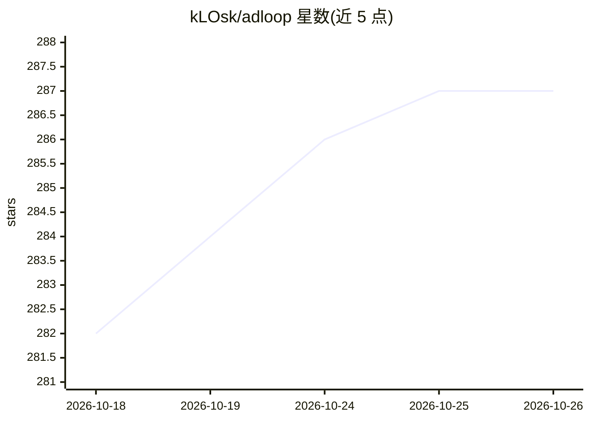

# kLOsk/adloop

⭐ 287 · Python · MIT · 推送 2026-10-23 · [GitHub](https://github.com/kLOsk/adloop) · [官网](https://getadloop.com) · 个人维护

**让 AI 助手读写 Google Ads/GA4 的 MCP 服务器，带防误花钱护栏**

一个 MCP 服务器，向 AI 助手（Claude Code、Cursor、Claude Desktop、ChatGPT 等）开放 Google Ads、Reddit Ads 与 GA4 的读+写访问：提供 GA4 报表、广告/关键词/受众/品牌列表等大量读取工具，以及草稿类写工具；写操作先出预览、需用户确认，新广告与系列默认暂停。还提供 Ads 与 GA4 数据交叉引用诊断（如转化缺口归因、GTM 三方审计）。自托管需自有 Google Cloud 项目，pip 安装；另有托管版 AdLoop Cloud（免费档）。

## 筛选速览

| 维度 | 判定 | 备注 |
|---|---|---|
| AI 角色 | `ai-ecosystem` | LLM/agent 周边工具 |
| 许可风险 | `permissive` | MIT |
| 部署形态 | `library` | 以包/库形式分发 |
| 模型依赖 | — | README 未给出锁定关系 |
| 硬件要求 | — | 无带数字的原话,不猜 |
| 安装摩擦 | `low` | 无编译、无系统依赖或容器化 |
| 成熟度 | — | 结构信号不足 |

## 能力要点

- 读+写 Google Ads、Reddit Ads、GA4 的 MCP 工具集
- 安全护栏：预览+用户确认才生效，新广告默认暂停
- Ads 与 GA4 交叉引用诊断（转化缺口、追踪、GTM 三方审计）
- compact 模式压缩响应约 90%，避免填满 AI 上下文

## 适用场景

- 在 IDE 里通过对话查广告数据、加否定关键词
- 排查转化下跌原因（GDPR 拒绝/追踪损坏/落地页问题）
- 用自然语言草拟搜索广告与广告系列并确认后上线

## 场景标签

 · 领域:营销/广告数据接入工具

## 证据(README 行号)

> L14: An MCP server that gives your AI assistant read + write access to Google Ads, Reddit Ads and GA4 — with safety guar
> L32: |**Works with**|claude.ai, ChatGPT, Claude Code, Cursor, Gemini|Claude Code, Cursor, Claude Desktop, any local MCP 

## 星数曲线

2026-10-18 282 → 2026-10-26 287（+5）

---
*卡片 v1 · prompt 1.4 · 生成 2026-10-22 · 置信度 high · 依据 README sha `a94266a3cdc1` · [字段定义](../../DATASET.md)*
