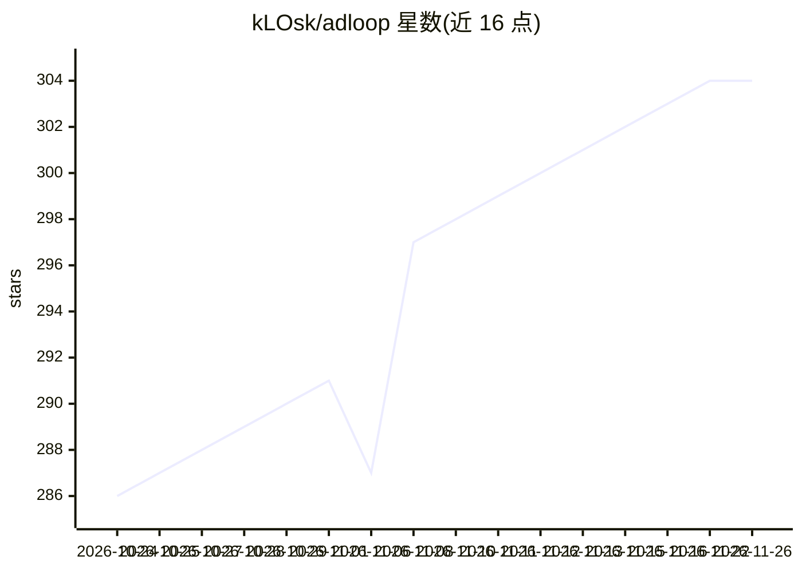

# kLOsk/adloop

⭐ 304 · Python · MIT · 推送 2026-11-25 · [GitHub](https://github.com/kLOsk/adloop) · [官网](https://getadloop.com) · 个人维护

**给 Claude/ChatGPT/Cursor 接入 Google Ads 的 MCP server**

一个 MCP server，让 AI 客户端对 Google Ads、Reddit Ads 和 GA4 获得读写访问，覆盖广告系列/关键词/受众/品牌列表等约 40 个工具，并提供 Ads 与 GA4 数据的交叉诊断（转化归因、追踪事件比对、GTM 容器审计）。所有写入变更先出预览、需用户确认后才生效，新广告默认暂停。提供 AdLoop Cloud 托管版（免费计划+付费计划）与自托管版（pip 安装，需自建 Google Cloud 项目），MIT 许可。

## 筛选速览

| 维度 | 判定 | 备注 |
|---|---|---|
| AI 角色 | `ai-ecosystem` | LLM/agent 周边工具 |
| 许可风险 | `permissive` | MIT |
| 部署形态 | `library` | 以包/库形式分发 |
| 模型依赖 | — | README 未给出锁定关系 |
| 硬件要求 | — | 无带数字的原话,不猜 |
| 安装摩擦 | `low` | 无编译、无系统依赖或容器化 |
| 成熟度 | — | 结构信号不足 |

## 能力要点

- 40+ 只读工具：广告系列、关键词、PMax、受众、品牌列表、GA4 报表、任意 GAQL 查询
- 写入前预览与确认机制，新广告/广告系列默认暂停
- Ads 点击 × GA4 会话 × GTM 容器的三方交叉审计，含 GDPR 同意缺口识别
- AdLoop Cloud 托管版与自托管版运行同一工具集与安全模型

## 适用场景

- 在 IDE 对话中排查转化下降：一次查询交叉比对 Ads 与 GA4 数据
- 从搜索词报表中识别无效流量并添加否定关键词
- 用自然语言起草响应式搜索广告并逐条确认上线
- 核对代码库中的埋点事件与 GA4 实际接收事件的差异

## 场景标签

`数据分析` · 领域:效率与自动化

## 证据(README 行号)

> L16: An MCP server that gives your AI assistant read + write access to Google Ads, Reddit Ads and GA4 — with safety guar
> L34: |**Works with**|claude.ai, ChatGPT, Claude Code, Cursor, Gemini|Claude Code, Cursor, Claude Desktop, any local MCP 

## 星数曲线

2026-10-24 286 → 2026-11-26 304（+18）

---
*卡片 v1 · prompt 1.4 · 生成 2026-11-25 · 置信度 high · 依据 README sha `a8b7f43a6e68` · [字段定义](../../DATASET.md)*
