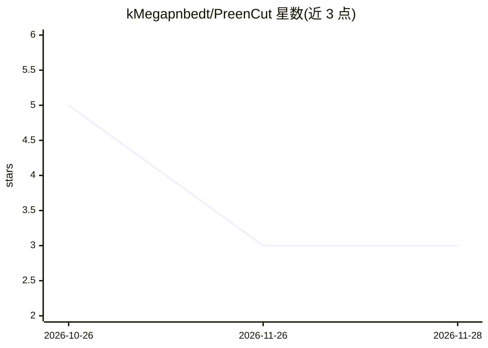

# kMegapnbedt/PreenCut

⭐ 3 · Python · MIT · 推送 2026-10-19 · [GitHub](https://github.com/kMegapnbedt/PreenCut) · 个人维护 · 中文 README

**用语音识别加 LLM 从视频/音频中按自然语言检索并导出片段**

面向需要从音视频素材中提取片段的用户，提供 Gradio Web 界面与 REST API：先用 Whisper 转录，再由大语言模型对内容分段、摘要并打标签，用户可用自然语言查询定位片段，导出为 ZIP、合并视频或 SRT 字幕，支持多文件批量处理与改写提示词后复用已有转录结果重新分析。安装需 Python 环境、pip 依赖与 FFmpeg，LLM 服务需在 config.py 配置并设置 API key。

## 筛选速览

| 维度 | 判定 | 备注 |
|---|---|---|
| AI 角色 | `ai-native` | 本体是模型或模型工具 |
| 许可风险 | `permissive` | MIT |
| 部署形态 | `library` | 以包/库形式分发 |
| 模型依赖 | — | README 未给出锁定关系 |
| 硬件要求 | — | 无带数字的原话,不猜 |
| 安装摩擦 | `medium` | 含编译或系统依赖之一 |
| 成熟度 | — | 结构信号不足 |

## 能力要点

- Whisper 转录 + LLM 分段摘要与打标
- 自然语言查询定位片段，支持多文件批量处理
- 导出 ZIP/合并视频/SRT 字幕，Re-analyze 免重复转录
- 提供 Gradio 界面与 /api 路由的 REST API

## 适用场景

- 从长视频里找出所有产品演示片段并导出
- 为音视频内容批量生成带时间戳的 SRT 字幕
- 换不同提示词反复分析同一批素材找选题

## 场景标签

`语音识别` `语义搜索` `图像视频处理` · 领域:知识与检索

## 证据(README 行号)

> L9: PreenCut is an intelligent video editing tool that automatically analyzes audio/video content using speech recogniti
> L19: - **Automatic Speech Recognition**: Powered by OpenAI Whisper for accurate transcription
> L21: - **AI-Powered Analysis**: Uses large language models to segment and summarize content

## 星数曲线

2026-10-26 5 → 2026-11-28 3（-2）

---
*卡片 v1 · prompt 1.4 · 生成 2026-11-21 · 置信度 mid · 依据 README sha `f5aa2efc4e91` · [字段定义](../../DATASET.md)*
