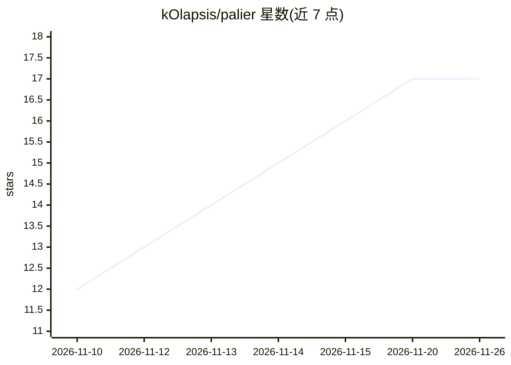

# kOlapsis/palier

⭐ 17 · Go · Apache-2.0 · 推送 2026-11-25 · [GitHub](https://github.com/kOlapsis/palier) · [官网](https://kolapsis.github.io/palier/) · 个人维护

**自托管 Docker Compose 栈的自动更新工具，AI 读取发版说明规划升级路径**

以单个 Go 二进制/容器运行的 Docker Compose 更新工具：盘点本机容器组成栈，从 OCI registry 查新版本，读取每一跳过版本的 release notes 与安全公告，由 AI 从封闭操作清单（set_image/compose_edit/db_dump_restore 等）生成升级计划，代码校验后逐步执行，每步建立还原点，失败即回滚。支持 PostgreSQL/MySQL/MariaDB 大版本导出重导入升级。默认 Anthropic，可切 OpenAI 兼容 API（含 Ollama/vLLM）；无 AI key 时仅按版本号更新。限制：单机、仅读 GitHub/gitlab.com 的 notes。

## 筛选速览

| 维度 | 判定 | 备注 |
|---|---|---|
| AI 角色 | `ai-enhanced` | 去掉 AI 部分产品仍成立 |
| 许可风险 | `none` | Apache-2.0 |
| 部署形态 | `self-host` | docker 或自建部署 |
| 模型依赖 | local-ok | 支持本地模型 |
| 硬件要求 | — | 无带数字的原话,不猜 |
| 安装摩擦 | `low` | 无编译、无系统依赖或容器化 |
| 成熟度 | — | 结构信号不足 |

## 能力要点

- 读取全部中间版本 release notes 与安全公告后由 AI 生成封闭操作集的升级计划
- 逐步执行、每步全栈还原点、失败回滚到最后验证步骤
- 数据库大版本经导出重导入升级并比对角色/表/行/索引
- 备份可经 rclone 发往 S3/SFTP/WebDAV，备份失败则不应用更新

## 适用场景

- 无人值守地升级 GitLab、Immich 等有强制升级停靠点的大版本栈
- 自托管 homelab 多个 Compose 栈的日常补丁与安全更新
- 在不可跳版本、Compose 结构变更的升级中避免半更新状态

## 场景标签

 · 领域:容器运维/DevOps 自动化

## 证据(README 行号)

> L8: Palier updates the Docker Compose stacks of a machine on its own. It does more than bump a tag: it reads the release
> L95: - **An AI key** is needed in practice. Without it, Palier works on version numbers only, without reading what chang

## 星数曲线

2026-11-10 12 → 2026-11-26 17（+5）

---
*卡片 v1 · prompt 1.4 · 生成 2026-11-18 · 置信度 mid · 依据 README sha `b00d9a1156ce` · [字段定义](../../DATASET.md)*
