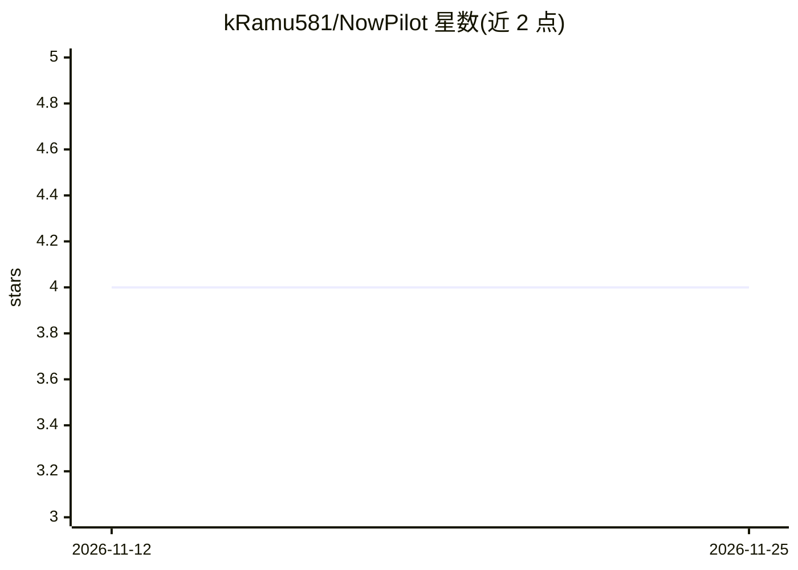

# kRamu581/NowPilot

⭐ 4 · JavaScript · Apache-2.0 · 推送 2026-11-14 · [GitHub](https://github.com/kRamu581/NowPilot) · [官网](https://kramu581.github.io/NowPilot/) · 个人维护

**面向 ServiceNow 的人工审批式开源 AI Agent**

部署在 ServiceNow 平台上的开源 AI Agent，提供积压故事分解、ATF 测试思路生成、代码重构建议、上下文感知聊天与 ITSM 工单知识关联。所有写操作以密封提案卡形式呈现，经人工确认 Accept 后才落库，数据库访问经由 GlideRecordSecure 并强制 ACL。支持 9 家 AI 提供商的能力感知路由，Apache-2.0 许可，可通过 local_runner.js 在无 ServiceNow 实例的本地模拟环境运行。

## 筛选速览

| 维度 | 判定 | 备注 |
|---|---|---|
| AI 角色 | `ai-native` | 本体是模型或模型工具 |
| 许可风险 | `permissive` | Apache-2.0 |
| 部署形态 | `None` |  |
| 模型依赖 | local-ok | 支持本地模型 |
| 硬件要求 | — | 无带数字的原话,不猜 |
| 安装摩擦 | `low` | 无编译、无系统依赖或容器化 |
| 成熟度 | — | 结构信号不足 |

## 能力要点

- 写操作提案制：HMAC-SHA256 密封提案，人工 Accept 后才写入
- 9 家 AI 提供商统一接入与按 Reasoning/Vision/Code/Fast 能力路由
- 本地 mock 运行器无需 ServiceNow 实例即可测试界面
- ITSM 工单与历史已解决事件、知识库文章关联并强制引用完整性

## 适用场景

- 让 AI 分解 Jira 故事并生成带验收标准的构建计划
- 为 ServiceNow 升级生成 ATF 自动化测试思路
- 审查并重写含 current.update() 等风险模式的 Business Rule 代码

## 场景标签

`RAG` `代码审查` `AI 助手` · 领域:编码与开发

## 证据(README 行号)

> L5: ### The open-source AI agent that **never writes to production without you.**
> L63: |One vendor’s models only|**Google Gemini 2.0 Flash, Claude, GPT-4o, Grok, DeepSeek, Ollama, vLLM** — route how you
> L116: NowPilot features a unified AI provider architecture supporting 9 leading AI providers with capability-aware routi

## 星数曲线

2026-11-12 4 → 2026-11-25 4（+0）

---
*卡片 v1 · prompt 1.4 · 生成 2026-11-21 · 置信度 high · 依据 README sha `297a2f867cec` · [字段定义](../../DATASET.md)*
