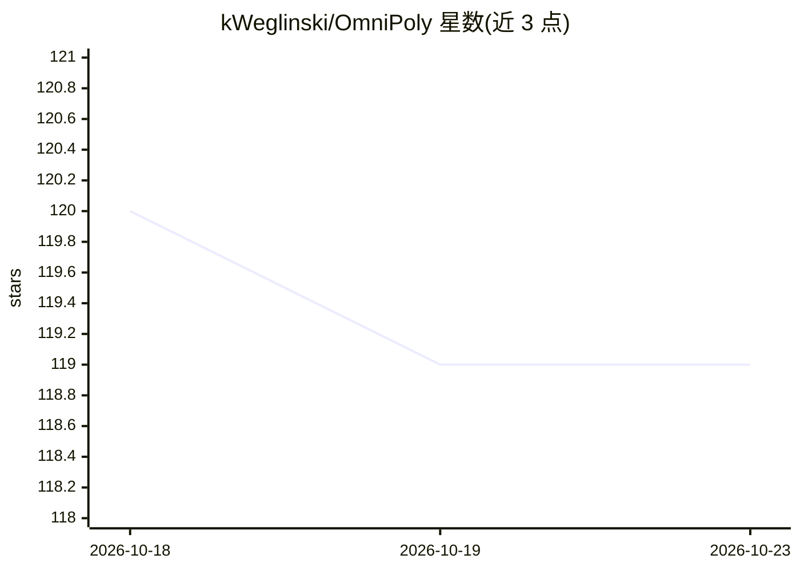

# kWeglinski/OmniPoly

⭐ 119 · HTML · GPL-3.0 · 推送 2026-04-24 · [GitHub](https://github.com/kWeglinski/OmniPoly) · 个人维护

**自托管翻译与语法检查前端：整合 LibreTranslate/LanguageTool/Ollama**

面向自托管用户的翻译与语言处理 Web 前端：通过 LibreTranslate 提供多语言文本翻译（支持文件上传与译文下载），通过 LanguageTool 做语法检查（错误高亮、应用修正、自定义词典），并可选接入 Ollama 用 LLM 做情感分析与有趣句子提取。三个后端均可通过环境变量开关，未配置的功能自动隐藏。推荐 Docker Compose 部署，也可本地 npm 运行开发服务器；需自行另起 LibreTranslate 与 LanguageTool 后端。

## 筛选速览

| 维度 | 判定 | 备注 |
|---|---|---|
| AI 角色 | `ai-ecosystem` | LLM/agent 周边工具 |
| 许可风险 | `viral` | GPL-3.0 |
| 部署形态 | `self-host` | docker 或自建部署 |
| 模型依赖 | local-ok | 支持本地模型 |
| 硬件要求 | — | 无带数字的原话,不猜 |
| 安装摩擦 | `low` | 无编译、无系统依赖或容器化 |
| 成熟度 | — | 结构信号不足 |

## 能力要点

- LibreTranslate 多语言翻译，支持文件上传与译文下载
- LanguageTool 语法检查：错误高亮、应用修正、词典自定义
- 可选接入 Ollama 做情感分析与句子提取，未配置的功能自动隐藏
- 提供 Docker Compose 配置与本地 npm 开发运行方式

## 适用场景

- 给自托管 LibreTranslate/LanguageTool 配一个记住偏好的图形前端
- 翻译文本同时做语法检查与 AI 情感分析
- 自托管一套可私有部署的翻译与语言工具链

## 场景标签

`AI 写作` · 领域:内容生成

## 证据(README 行号)

> L14: Welcome to **OmniPoly**! This project is a comprehensive solution for translation and language enhancement. It inte
> L19: - AI-Powered Insights: Utilizes Large Language Models to analyze sentiments and extract interesting sentences, addi
> L44: If you prefer not to use any of the following systems—AI, LanguageTool, or LibreTranslate—for any reason, you can e

## 星数曲线

2026-10-18 120 → 2026-10-23 119（-1）

---
*卡片 v1 · prompt 1.4 · 生成 2026-10-23 · 置信度 mid · 依据 README sha `8a4b0cd34f81` · [字段定义](../../DATASET.md)*
