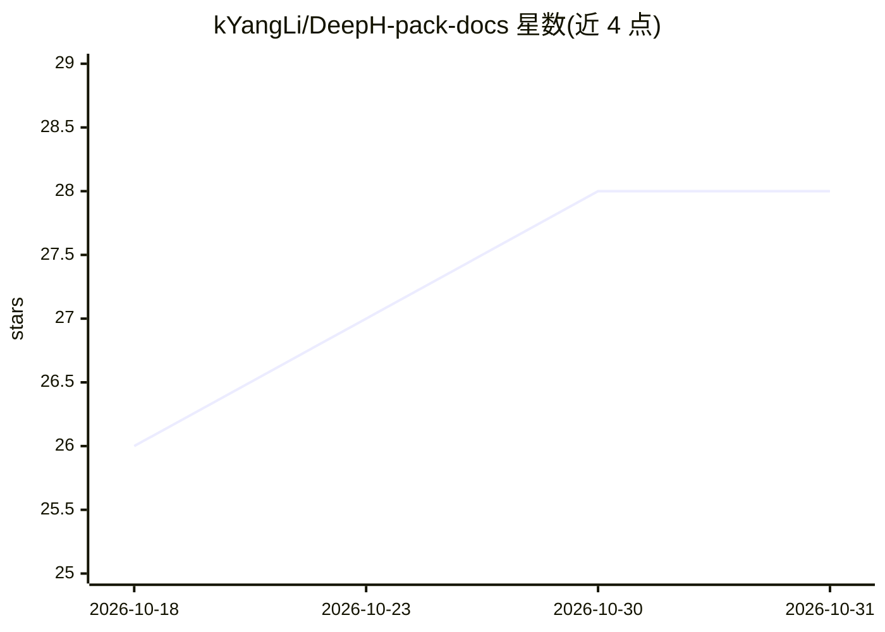

# kYangLi/DeepH-pack-docs

⭐ 28 · Python · AGPL-3.0 · 推送 2026-09-27 · [GitHub](https://github.com/kYangLi/DeepH-pack-docs) · [官网](https://docs.deeph-pack.com/deeph-pack) · 组织维护

**用神经网络做密度泛函理论电子结构计算的通用软件包**

DeepH 系列方法的统一软件包，基于 JAX 与 Flax 重写，用于深度学习密度泛函理论（DFT）哈密顿量，加速从头算电子结构计算，服务计算材料科学研究。提供 deeph-train / deeph-infer 两个命令行入口完成训练与推理；软件需在官方网站申请获取 wheel 文件后本地 pip 安装，支持 GPU（需预装 CUDA 12.8/12.9）与 CPU 两种版本，要求 Python 3.13 与 uv。整合了 DeepH-E3、DeepH-2、DeepH-Zero、HPRO 等前代方法。

## 筛选速览

| 维度 | 判定 | 备注 |
|---|---|---|
| AI 角色 | `ai-native` | 本体是模型或模型工具 |
| 许可风险 | `viral` | AGPL-3.0 |
| 部署形态 | `library` | 以包/库形式分发 |
| 模型依赖 | — | README 未给出锁定关系 |
| 硬件要求 | — | 无带数字的原话,不猜 |
| 安装摩擦 | `medium` | 含编译或系统依赖之一 |
| 成熟度 | — | 结构信号不足 |

## 能力要点

- 基于 JAX/Flax 重写的 DeepH 统一软件包
- deeph-train / deeph-infer 命令行工作流
- 提供 GPU 与 CPU 两种安装变体（wheel 文件需官网申请）
- 整合 DeepH-E3/DeepH-2/DeepH-Zero/HPRO 等系列方法

## 适用场景

- 用神经网络近似 DFT 哈密顿量加速材料电子结构计算
- 训练并推理材料体系的深度学习电子结构模型
- 在 GPU 环境下批量开展计算材料学研究

## 场景标签

 · 领域:计算材料科学/电子结构计算

## 证据(README 行号)

> L3: ### *A General-purpose Neural Network Package for Deep-learning Electronic Structure Calculations*
> L22: The modernized DeepH-pack is built upon the solid foundation of its predecessor and has been re-engineered with JAX
> L52: deeph-infer infer.toml

## 星数曲线

2026-10-18 26 → 2026-10-31 28（+2）

---
*卡片 v1 · prompt 1.4 · 生成 2026-10-26 · 置信度 high · 依据 README sha `21939deb89cc` · [字段定义](../../DATASET.md)*
