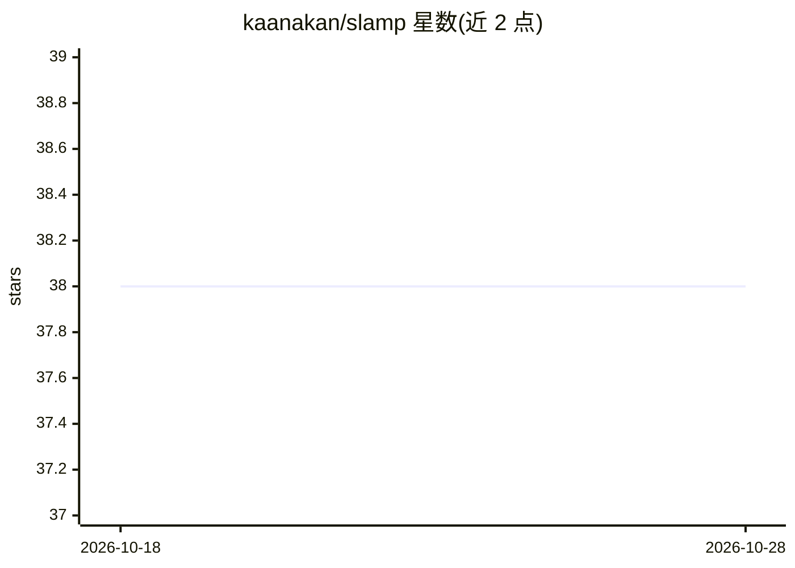

# kaanakan/slamp

⭐ 38 · Python · Apache-2.0 · 推送 2026-07-23 · [GitHub](https://github.com/kaanakan/slamp) · [官网](https://kuis-ai.github.io/slamp/) · 个人维护

**随机视频未来帧预测模型（ICCV 2021）官方 PyTorch 实现**

ICCV 2021 论文 SLAMP 的官方 PyTorch 实现：基于随机潜在变量模型预测视频未来帧，分离外观与运动潜变量。支持在 Stochastic Moving MNIST、KTH、BAIR、KITTI、Cityscapes 五个数据集上训练（train.py）与评测（evaluate.py），评测输出 PSNR、SSIM、LPIPS，另有 calculate_fvd.py 计算 FVD。训练使用 Python 3.7.6、PyTorch 1.4.0 与 CUDA 10.1，依赖列于 requirements.txt；评测需目录下含 LPIPS v0.1 权重。提供各数据集的预训练权重下载链接。面向视频预测与自动驾驶研究者。

## 筛选速览

| 维度 | 判定 | 备注 |
|---|---|---|
| AI 角色 | `ai-native` | 本体是模型或模型工具 |
| 许可风险 | `permissive` | Apache-2.0 |
| 部署形态 | `None` |  |
| 模型依赖 | — | README 未给出锁定关系 |
| 硬件要求 | — | 无带数字的原话,不猜 |
| 安装摩擦 | `medium` | 含编译或系统依赖之一 |
| 成熟度 | — | 结构信号不足 |

## 能力要点

- 外观与运动潜变量分离的随机视频预测模型
- 覆盖 MNIST/KTH/BAIR/KITTI/Cityscapes 五个数据集的训练与评测流程
- 提供各数据集预训练权重下载
- 评测指标包括 PSNR、SSIM、LPIPS 与 FVD

## 适用场景

- 复现论文实验结果或使用预训练权重做视频预测
- 在 KITTI/Cityscapes 上做自动驾驶场景的未来帧预测
- 以本实现为基线开展视频预测研究

## 场景标签

`视频生成` · 领域:内容生成

## 证据(README 行号)

> L3: Official implementation of the paper *SLAMP: Stochastic Latent Appearance and Motion Prediction* (Adil Kaan Akan, Er
> L15: All models were trained with Python 3.7.6 and PyTorch 1.4.0 using CUDA 10.1.

## 星数曲线

2026-10-18 38 → 2026-10-28 38（+0）

---
*卡片 v1 · prompt 1.4 · 生成 2026-10-25 · 置信度 high · 依据 README sha `0a0e1774885d` · [字段定义](../../DATASET.md)*
