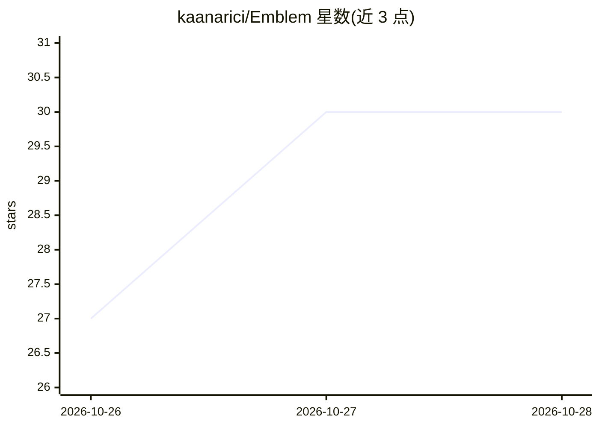

# kaanarici/Emblem

⭐ 30 · Swift · AGPL-3.0 · 推送 2026-10-26 · [GitHub](https://github.com/kaanarici/Emblem) · 个人维护

**开源 iPhone AI 助手：回答以原生页面而非文字段落呈现**

用 SwiftUI 编写的 iPhone 个人助理应用，回答以原生页面交付：地图与逐日行程、食谱步骤卡、并排对比、时间线、图表等类型化块由服务端流式下发、手机原生渲染。请求含糊时先弹出快速提问表单；支持语音输入、聚合日历/提醒/天气，并通过 Composio 连接 Gmail 与 Google Calendar。模型侧支持任一带工具调用的 OpenRouter 模型或 Cerebras/OpenAI/Google/Groq，也可用设备端 Apple Intelligence。服务端为 Next.js + Convex，需自建部署，AGPL-3.0 许可。

## 筛选速览

| 维度 | 判定 | 备注 |
|---|---|---|
| AI 角色 | `ai-native` | 本体是模型或模型工具 |
| 许可风险 | `viral` | AGPL-3.0 |
| 部署形态 | `library` | 以包/库形式分发 |
| 模型依赖 | locked-api |  |
| 硬件要求 | — | 无带数字的原话,不猜 |
| 安装摩擦 | `low` | 无编译、无系统依赖或容器化 |
| 成熟度 | — | 结构信号不足 |

## 能力要点

- 服务端流式下发类型化 JSON 块，SwiftUI 原生渲染为地图/行程/食谱/对比等页面
- 开放式请求先返回快速提问表单再执行研究（工具调用：搜索/地点/天气/酒店/已连接应用）
- 支持任一 OpenRouter 模型及 Cerebras/OpenAI/Google/Groq，或设备端 Apple Intelligence
- Gmail/Google Calendar 经 Composio 接入，Apple 日历/提醒/音乐走本机

## 适用场景

- 向手机助手提问并以原生页面获得行程、食谱、对比等结构化回答
- 把 iPhone 日历、提醒与 Google Calendar 汇聚到一处按日/周/月查看
- 自托管并自选模型提供商的 iOS AI 助手

## 场景标签

`AI 助手` · 领域:对话与助手

## 证据(README 行号)

> L7: Emblem is an iPhone assistant that answers with native pages. Ask about a trip and you get a map and a day-by-day pl
> L19: - **Any model.** Any OpenRouter model with tool calling and structured outputs (tested with Claude, Gemini, DeepSee

## 星数曲线

2026-10-26 27 → 2026-10-28 30（+3）

---
*卡片 v1 · prompt 1.4 · 生成 2026-10-26 · 置信度 high · 依据 README sha `46b01a2a6706` · [字段定义](../../DATASET.md)*
