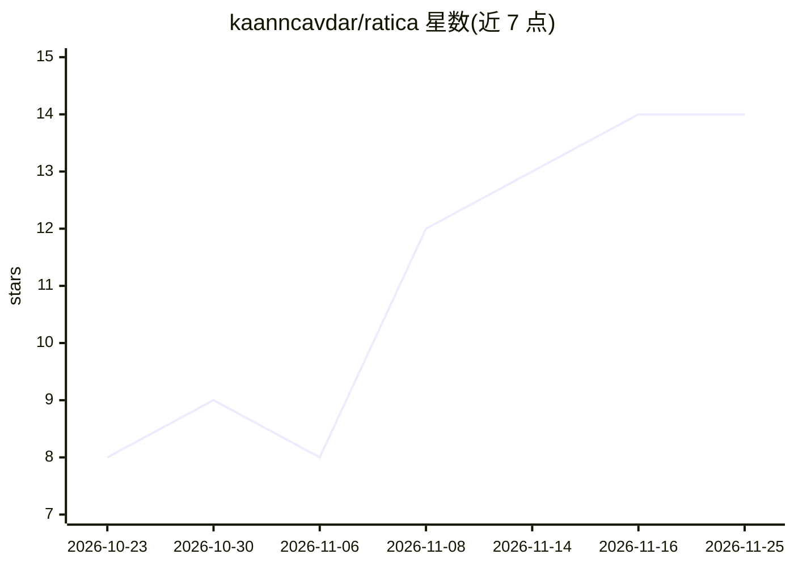

# kaanncavdar/ratica

⭐ 14 · Python · AGPL-3.0 · 推送 2026-10-07 · [GitHub](https://github.com/kaanncavdar/ratica) · [官网](https://ratica.kaancavdar.com) · 个人维护

**离线 AI PDF 整书翻译器，保留原版式并输出 EPUB**

在本地计算机上运行 PDF 书籍翻译的桌面应用：读取 PDF 后由本地 AI 模型（Gemma，经 llama.cpp 运行）逐段翻译，将译文写回原页面，保留标题、目录、图表、颜色与公式的原布局，同时输出适配电纸书的 EPUB。支持 23 种语言互译并自动识别书籍语言，可暂停续传。文件不上传，仅首次启动联网下载引擎与模型（约 5-6 GB）。扫描版 PDF 暂不支持，界面目前仅有英文。Windows/macOS/Linux 提供安装包。

## 筛选速览

| 维度 | 判定 | 备注 |
|---|---|---|
| AI 角色 | `ai-native` | 本体是模型或模型工具 |
| 许可风险 | `viral` | AGPL-3.0 |
| 部署形态 | `desktop` | 安装包/桌面程序 |
| 模型依赖 | — | README 未给出锁定关系 |
| 硬件要求 | — | 无带数字的原话,不猜 |
| 安装摩擦 | `medium` | 含编译或系统依赖之一 |
| 成熟度 | `idea` | |

## 能力要点

- 逐段翻译并写回原页面，保留原版式
- 同时输出 EPUB，支持 23 种语言互译与语言自动识别
- 完全本地运行：无云端、无账号、无 API key
- 自动检测硬件、下载引擎与模型并测速（约 5-6 GB）

## 适用场景

- 离线翻译数百页的教材、手册与小说且保留原排版
- 把译好的书放到电纸书上以 EPUB 阅读
- 在注重隐私的环境下翻译文档而不上传文件

## 场景标签

 · 领域:文档翻译/桌面应用

## 证据(README 行号)

> L17: Ratica is an offline **PDF book translator**. It reads a PDF, translates it paragraph by paragraph with a local AI 
> L26: has lost its layout. Ratica is a **local PDF translator** instead. It runs entirely on your own computer with a

## 星数曲线

2026-10-23 8 → 2026-11-25 14（+6）

---
*卡片 v1 · prompt 1.4 · 生成 2026-11-18 · 置信度 high · 依据 README sha `5c858f794e20` · [字段定义](../../DATASET.md)*
