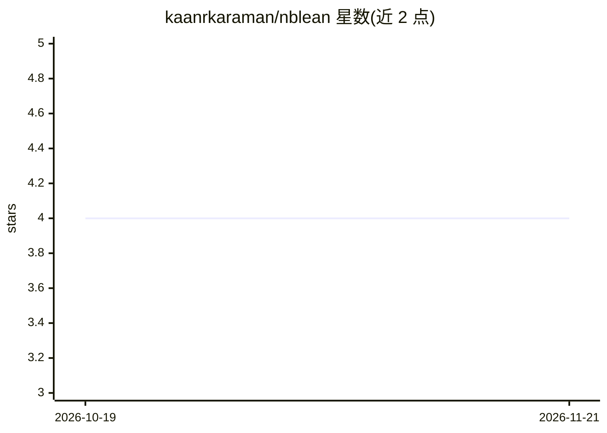

# kaanrkaraman/nblean

⭐ 4 · Rust · MIT · 推送 2026-10-24 · [GitHub](https://github.com/kaanrkaraman/nblean) · [官网](https://pypi.org/project/nblean/) · 个人维护

**给编码 agent 省Token访问 Jupyter notebook 的 CLI**

nblean 提供一个 Rust 单二进制 CLI 与 agent 技能，让编码 agent 按单元格操作 .ipynb：outline 生成逐单元格概览、show 按需读取并裁剪输出、errors 只显示失败单元格、grep 按单元格检索源码，run/eval 在常驻 ipykernel 后台进程中执行代码并把绘图存为文件路径。支持 Claude Code、Codex、OpenCode、Gemini CLI 的 SKILL.md 技能安装。局限：长单元格被杀时输出丢失、不支持 widgets 与 input()。

## 筛选速览

| 维度 | 判定 | 备注 |
|---|---|---|
| AI 角色 | `ai-ecosystem` | LLM/agent 周边工具 |
| 许可风险 | `permissive` | MIT |
| 部署形态 | `library` | 以包/库形式分发 |
| 模型依赖 | — | README 未给出锁定关系 |
| 硬件要求 | — | 无带数字的原话,不猜 |
| 安装摩擦 | `low` | 无编译、无系统依赖或容器化 |
| 成熟度 | — | 结构信号不足 |

## 能力要点

- outline 一行一单元格的概览，输出裁剪为首尾行
- 常驻 ipykernel 后台进程，变量跨命令保留在内存
- 绘图保存为文件，只向 agent 打印路径
- 单 Rust 二进制，PyPI 提供多平台预编译 wheel

## 适用场景

- 让编码 agent 调试和修改大型 EDA notebook 时减少读取全部输出
- 只重跑出错单元格而非整个 notebook
- 在 Claude Code/Codex 等 agent 中以技能形式启用 notebook 操作

## 场景标签

`编码 Agent` · 领域:编码与开发

## 证据(README 行号)

> L20: nblean is a small CLI and agent skill that lets the agent work one cell at a time. It
> L177: The skill uses the Agent Skills `SKILL.md` format, so the

## 星数曲线

2026-10-19 4 → 2026-11-21 4（+0）

---
*卡片 v1 · prompt 1.4 · 生成 2026-11-21 · 置信度 high · 依据 README sha `b7d1031313a6` · [字段定义](../../DATASET.md)*
