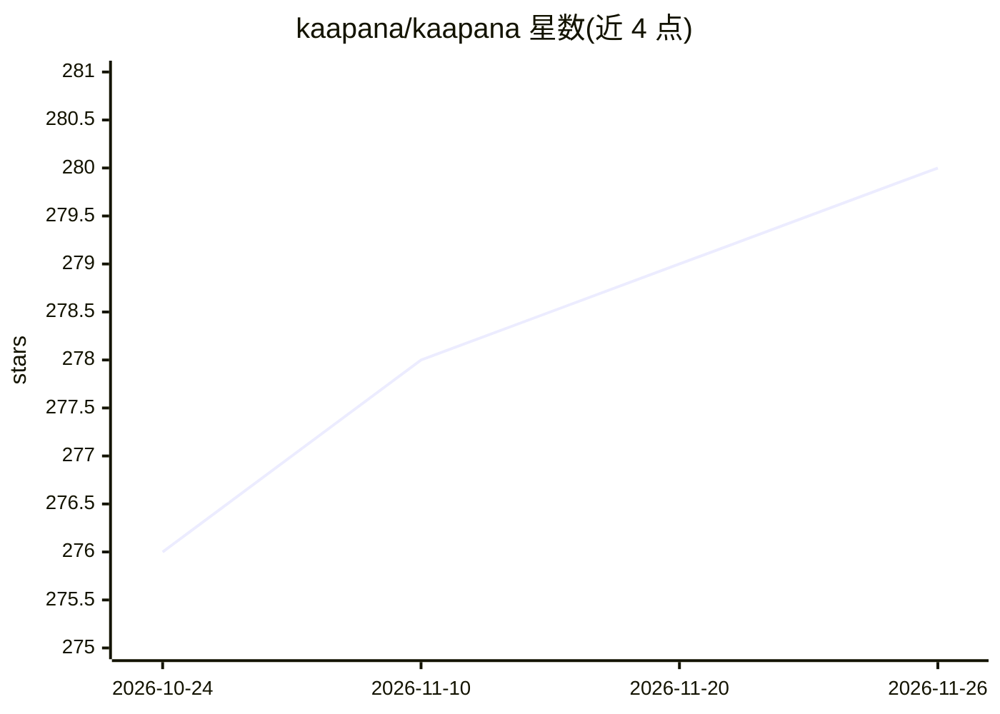

# kaapana/kaapana

⭐ 280 · Python · AGPL-3.0 · 推送 2026-11-25 · [GitHub](https://github.com/kaapana/kaapana) · [官网](https://www.kaapana.ai) · 组织维护

**面向医疗影像分析的开放平台工具包与联邦学习框架**

Kaapana 是一个开源的医疗数据分析平台工具包，面向研究人员与临床机构，用于在多中心场景下部署 AI 工作流与联邦学习，重点覆盖放射与放射治疗影像。它提供工作流管理（内置 nnU-Net、TotalSegmentator 等分割算法）、数据集探索与可视化、PACS/Minio 存储、Keycloak 用户管理及系统监控。技术栈基于 Kubernetes、Helm、Airflow、dcm4chee、OpenSearch、Grafana 等，遵循 AGPL 许可，由德国癌症研究中心（DKFZ）维护。构建与部署说明在文档站给出。

## 筛选速览

| 维度 | 判定 | 备注 |
|---|---|---|
| AI 角色 | `ai-ecosystem` | LLM/agent 周边工具 |
| 许可风险 | `viral` | AGPL-3.0 |
| 部署形态 | `None` |  |
| 模型依赖 | — | README 未给出锁定关系 |
| 硬件要求 | — | 无带数字的原话,不猜 |
| 安装摩擦 | `low` | 无编译、无系统依赖或容器化 |
| 成熟度 | — | 结构信号不足 |

## 能力要点

- 基于 Kubernetes/Airflow 的医疗影像工作流管理与执行
- 内置 nnU-Net、TotalSegmentator 等深度学习分割算法
- 联邦学习支持：数据留在各机构本地处理
- 集成 PACS（dcm4chee）、Keycloak 用户管理与系统监控

## 适用场景

- 在多家医院间开展分布式放射影像分析与量化研究
- 搭建符合临床 IT 基础设施的平台处理 DICOM 数据
- 在数据不出院内的前提下做多中心机器学习实验

## 场景标签

`工作流自动化` `图像视频处理` `目标检测` `数据分析` · 领域:效率与自动化

## 证据(README 行号)

> L11: Kaapana is an open-source toolkit for state-of-the-art platform provisioning in the field of medical data analysis.
> L15: Following this federated concept, the goal of Kaapana is to provide a framework and a set of tools for sharing data
> L19: Core components of Kaapana:

## 星数曲线

2026-10-24 276 → 2026-11-26 280（+4）

---
*卡片 v1 · prompt 1.4 · 生成 2026-11-26 · 置信度 high · 依据 README sha `704dc5c00772` · [字段定义](../../DATASET.md)*
