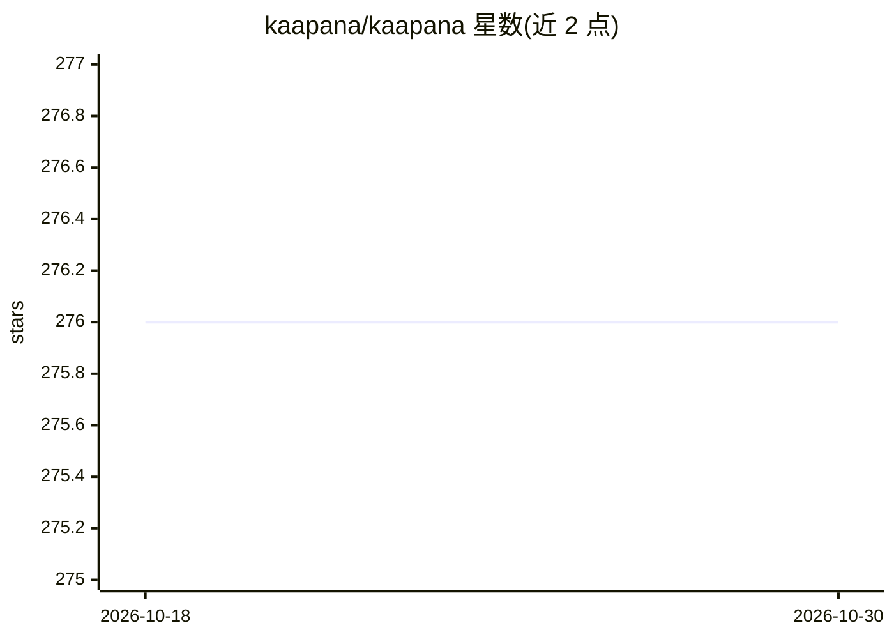

# kaapana/kaapana

⭐ 276 · Python · AGPL-3.0 · 推送 2026-10-29 · [GitHub](https://github.com/kaapana/kaapana) · [官网](https://www.kaapana.ai) · 组织维护

**医学影像 AI 平台工具包：联邦式数据处理与多中心研究**

由德国癌症研究中心（DKFZ）开发的开源医学数据分析平台供给工具包，基于 Kubernetes/Helm/Airflow 构建，提供工作流管理（含 nnU-Net 分割、TotalSegmentator 等深度学习算法）、医学影像数据集探索与策展、集成 PACS（dcm4chee）与 Minio 存储、Keycloak 用户管理及 Prometheus/Grafana 监控。遵循联邦理念，数据留在各机构本地处理，支持分布式方法开发与联邦学习，面向研究人员和临床医生开展多中心研究。采用 AGPL 许可，暂不提供预构建 Docker 容器。

## 筛选速览

| 维度 | 判定 | 备注 |
|---|---|---|
| AI 角色 | `ai-ecosystem` | LLM/agent 周边工具 |
| 许可风险 | `viral` | AGPL-3.0 |
| 部署形态 | `None` |  |
| 模型依赖 | — | README 未给出锁定关系 |
| 硬件要求 | — | 无带数字的原话,不猜 |
| 安装摩擦 | `low` | 无编译、无系统依赖或容器化 |
| 成熟度 | — | 结构信号不足 |

## 能力要点

- 基于 Kubernetes/Helm/Airflow 的容器化工作流平台
- 集成 nnU-Net、TotalSegmentator 等深度学习影像处理算法
- 联邦式架构：数据留在本地机构，支持分布式开发与联邦学习
- 内置 PACS（dcm4chee）、Minio、Keycloak、OHIF 查看器等组件

## 适用场景

- 在多个临床站点部署分布式放射影像分析与量化平台
- 开展数据不出院的多中心医学影像研究与联邦学习
- 在临床 IT 环境中运行标准化医学影像 AI 工作流

## 场景标签

`工作流自动化` · 领域:效率与自动化

## 证据(README 行号)

> L15: Following this federated concept, the goal of Kaapana is to provide a framework and a set of tools for sharing data
> L20: * **Workflow management:** Large-scale image processing with SOTA deep learning algorithms, such as nnU-Net image s

## 星数曲线

2026-10-18 276 → 2026-10-30 276（+0）

---
*卡片 v1 · prompt 1.4 · 生成 2026-10-22 · 置信度 high · 依据 README sha `4be721af41a0` · [字段定义](../../DATASET.md)*
