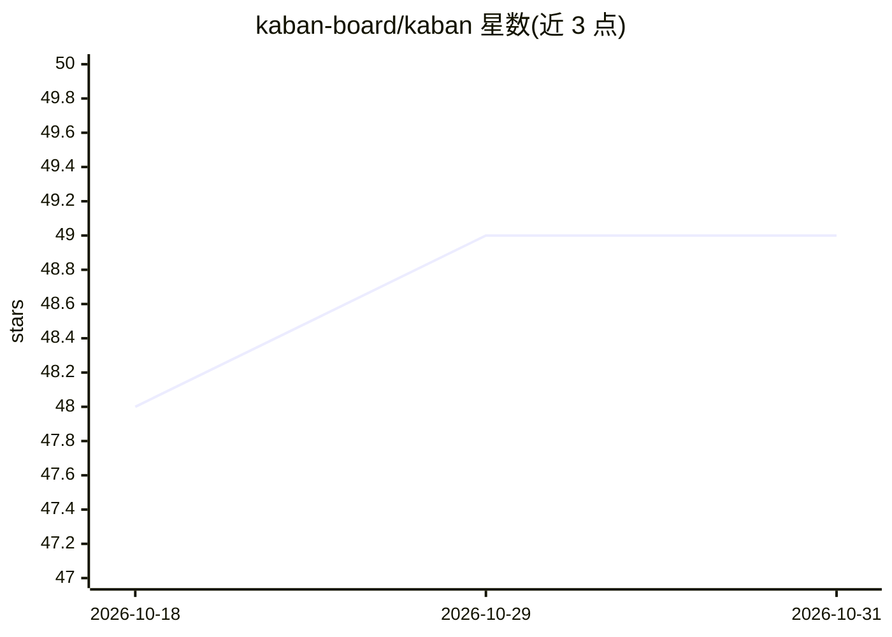

# kaban-board/kaban

⭐ 49 · TypeScript · MIT · 推送 2026-01-31 · [GitHub](https://github.com/kaban-board/kaban) · [官网](https://kaban-board.github.io/kaban/) · 个人维护

**面向 AI 代码代理与开发者的终端 Kanban 任务看板**

基于终端的 Kanban 看板，供人类与 AI 代码代理共同管理任务：提供交互式 TUI、可脚本化的 CLI 以及 MCP 服务器（含 20+ 个任务管理工具与资源接口），AI 代理可自主读写任务。支持将任务指派给 Claude、GPT 等代理并追踪归属；可通过 TodoWrite Hook 自动同步 Claude Code 的待办事项到看板。数据存储为单个 SQLite 文件，无需服务器、可离线使用，内置 WIP 限制与归档/全文搜索。经 npm、Homebrew 或源码安装。

## 筛选速览

| 维度 | 判定 | 备注 |
|---|---|---|
| AI 角色 | `ai-enhanced` | 去掉 AI 部分产品仍成立 |
| 许可风险 | `permissive` | MIT |
| 部署形态 | `library` | 以包/库形式分发 |
| 模型依赖 | locked-api |  |
| 硬件要求 | — | 无带数字的原话,不猜 |
| 安装摩擦 | `low` | 无编译、无系统依赖或容器化 |
| 成熟度 | — | 结构信号不足 |

## 能力要点

- MCP 服务器提供 20+ 任务管理工具与资源接口，AI 代理可自主操作看板
- TodoWrite Hook 自动同步 Claude Code 待办到看板列
- 单 SQLite 文件存储，无服务器、离线可用
- TUI（Vim 风格导航）+ CLI + MCP 三种使用方式

## 适用场景

- 在终端里统一管理我和 AI 代理共同推进的开发任务
- 让 Claude Code 等编码助手通过 MCP 直接读取和更新看板任务
- 用看板 WIP 限制与归档功能做个人或小团队的进度管理

## 场景标签

 · 领域:开发工具/任务管理

## 证据(README 行号)

> L25: Kaban is a terminal-based Kanban board designed for **AI code agents** and developers. It provides a structured way
> L38: |**MCP Server**|AI agents can read, create, and manage tasks autonomously|

## 星数曲线

2026-10-18 48 → 2026-10-31 49（+1）

---
*卡片 v1 · prompt 1.4 · 生成 2026-10-25 · 置信度 high · 依据 README sha `5db827eaa2e0` · [字段定义](../../DATASET.md)*
