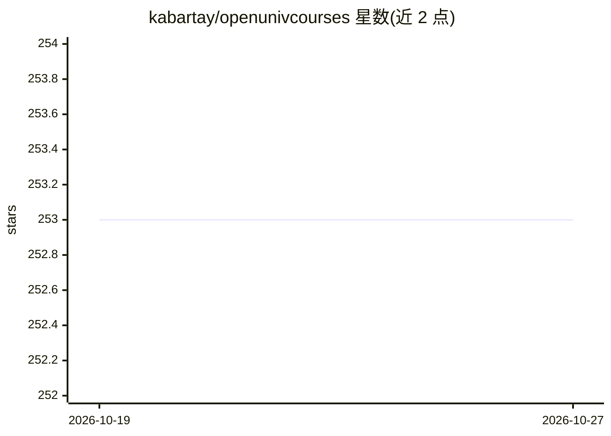

# kabartay/openunivcourses

⭐ 253 · Astro · MIT · 推送 2026-10-18 · [GitHub](https://github.com/kabartay/openunivcourses) · [官网](https://kabartay.github.io/openunivcourses/) · 个人维护

**免费大学机器学习课程聚合页：一页检索各年度课程链接**

将 MIT、Stanford、Berkeley、CMU、NYU、UChicago、Caltech 七所大学公开发布的机器学习课程聚合到单一可检索静态页面：收录 58 门课程、372 个年度版本（2005-2026），其中 90 个为讲座视频播放列表，每门课程附简介并链接其各年度版本。内容存于两个 YAML 文件，Astro 生成静态 HTML，GitHub Actions 构建部署并每周检查链接；本地运行需 Node 22.12+。新课程通过表单或编辑 courses.yaml 的 PR 提交。

## 筛选速览

| 维度 | 判定 | 备注 |
|---|---|---|
| AI 角色 | `ai-knowledge` | 知识聚合/清单类 |
| 许可风险 | `permissive` | MIT |
| 部署形态 | `None` |  |
| 模型依赖 | — | README 未给出锁定关系 |
| 硬件要求 | — | 无带数字的原话,不猜 |
| 安装摩擦 | `low` | 无编译、无系统依赖或容器化 |
| 成熟度 | — | 结构信号不足 |

## 能力要点

- 58 门课程、7 所大学、372 个年度版本，含 90 个讲座视频播放列表
- 按课程名、大学、主题搜索过滤
- 数据校验：构建时检查字段、URL、大学与 logo 一致性
- 每周自动检查课程链接并汇总失效链接

## 适用场景

- 查找某门 ML 课程的最新或含视频的年度版本
- 按大学或主题浏览免费公开的机器学习课程
- 发现从数学基础到 ML 系统等不同主题的大学课程

## 场景标签

`精选清单` · 领域:学习与行业

## 证据(README 行号)

> L5:  Free machine-learning courses from leading universities, in one searchable page.
> L29: **58 courses from 7 universities**, with 372 yearly editions from 2005 to 2026, 90 of them lecture-video playlists.

## 星数曲线

2026-10-19 253 → 2026-10-27 253（+0）

---
*卡片 v1 · prompt 1.4 · 生成 2026-10-22 · 置信度 high · 依据 README sha `8b26d0946408` · [字段定义](../../DATASET.md)*
