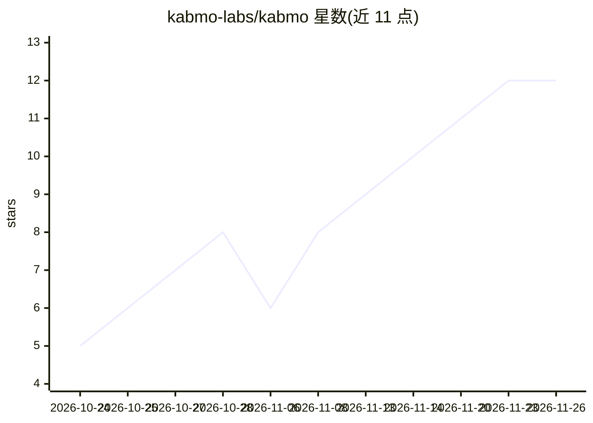

# kabmo-labs/kabmo

⭐ 12 · TypeScript · MIT · 推送 2026-11-25 · [GitHub](https://github.com/kabmo-labs/kabmo) · 组织维护

**AI 编码 agent 的 Web 控制台与诊断工作台，默认接 omp**

以 Web 形式提供面向 AI 编码 agent 的会话控制台与诊断工作台：读取 agent 自身的会话数据（omp 的 JSONL 存储、项目注册表、子 agent 转录，或 ACP agent 的协议数据），合并为实时视图并写回同一通道。默认通过 RPC 接 omp，另支持 15 种 ACP agent（含用户自加）。提供流式时间线、文件/编辑器、终端 PTY、源码管理、上下文与成本遥测、插件化右侧面板、fork/子会话编排、定时任务与本地语音听写。运行需 Bun 1.4+ 且 PATH 上有 omp 二进制，服务器缺 omp 拒绝启动；MOCK=true 可脱离真实 agent 用演示数据运行。

## 筛选速览

| 维度 | 判定 | 备注 |
|---|---|---|
| AI 角色 | `ai-ecosystem` | LLM/agent 周边工具 |
| 许可风险 | `permissive` | MIT |
| 部署形态 | `None` |  |
| 模型依赖 | — | README 未给出锁定关系 |
| 硬件要求 | — | 无带数字的原话,不猜 |
| 安装摩擦 | `medium` | 含编译或系统依赖之一 |
| 成熟度 | — | 结构信号不足 |

## 能力要点

- 默认走 omp RPC，另支持 15 种 ACP agent 与用户自加的启动行
- 能力探测而非假设：fork 等控件仅在该 agent 声明支持时出现
- 11 个右侧面板均为插件，可带视图、服务端、RPC 与实时主题
- 流式中途转向（steering）将提示送入运行中的回合而非取消

## 适用场景

- 在一个仪表板中监视、转向和审计多个 AI 编码 agent 的自治会话
- 按项目/工作区组织多 agent 会话并查看上下文用量与成本
- 通过 fork 与子会话把工作分派给不同 agent 并回收结果

## 场景标签

`编码 Agent` `多智能体` · 领域:Agent 开发

## 证据(README 行号)

> L3:  Web console and diagnostic workbench for AI coding agents.
> L25: The web app over a live agent install. It is not a terminal wrapper: Kabmo reads the agent's own
> L160: Kabmo is published to npm and runs on **Bun 1.4+**, not Node. Live capabilities need the `omp`

## 星数曲线

2026-10-24 5 → 2026-11-26 12（+7）

---
*卡片 v1 · prompt 1.4 · 生成 2026-11-19 · 置信度 high · 依据 README sha `a6bb3f5c906d` · [字段定义](../../DATASET.md)*
