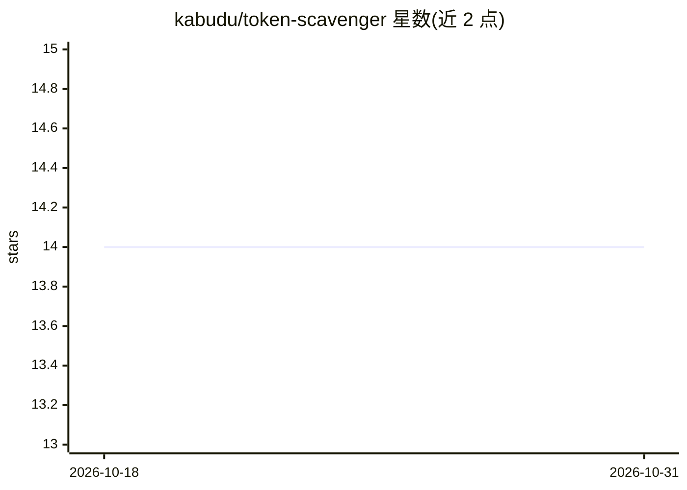

# kabudu/token-scavenger

⭐ 14 · Rust · MIT · 推送 2026-10-10 · [GitHub](https://github.com/kabudu/token-scavenger) · [官网](https://kabudu.github.io/token-scavenger/) · 个人维护

**自托管 OpenAI 兼容 LLM 路由器：优先本地与免费额度**

单个 Rust 静态二进制（约 15–25 MB）的自托管 LLM 路由器，后端 SQLite 存储：客户端仅需改 OpenAI SDK 的 base_url，即可经它路由到本地 OpenAI 兼容服务与 19 个内置提供方（含 Groq、OpenRouter、DeepSeek、xAI 等），按免费优先、可配置回退链与策略（min_cost/min_latency/local_only 等）选路。提供熔断/重试/健康监测、项目级 API key 与预算、嵌入式 Web 管理界面、Prometheus 指标、Homebrew/预编译二进制安装及 CLI 服务管理。带 OpenAI tools 的请求会自动偏向工具调用能力更强的模型。

## 筛选速览

| 维度 | 判定 | 备注 |
|---|---|---|
| AI 角色 | `ai-ecosystem` | LLM/agent 周边工具 |
| 许可风险 | `permissive` | MIT |
| 部署形态 | `None` |  |
| 模型依赖 | locked-api |  |
| 硬件要求 | — | 无带数字的原话,不猜 |
| 安装摩擦 | `medium` | 含编译或系统依赖之一 |
| 成熟度 | — | 结构信号不足 |

## 能力要点

- 免费/本地优先路由与可配置付费回退链，19 个内置提供方
- 完整 OpenAI 兼容 API（chat/embeddings/models，流式 SSE）
- 熔断、重试、健康监测与 Prometheus 指标、请求追踪
- 项目级 API key、预算上限与嵌入式运维面板

## 适用场景

- 把多个免费/付费 LLM 提供方聚合成一个 OpenAI 兼容端点
- 按成本或延迟策略为不同应用分配模型组与预算
- 为 agent 客户端自动选择工具调用能力强的模型

## 场景标签

`模型网关` · 领域:Agent 开发

## 证据(README 行号)

> L8: **A lightweight, single-binary, self-hosted OpenAI-compatible LLM router that intelligently scavenges local and free
> L10: **Just change the `base_url` in your OpenAI SDK** and TokenScavenger handles the rest: provider credentials, routin
> L162: TokenScavenger is a single Rust binary using Axum + Tokio + SQLite with these subsystems:

## 星数曲线

2026-10-18 14 → 2026-10-31 14（+0）

---
*卡片 v1 · prompt 1.4 · 生成 2026-10-31 · 置信度 high · 依据 README sha `7c1c6b6a6cab` · [字段定义](../../DATASET.md)*
