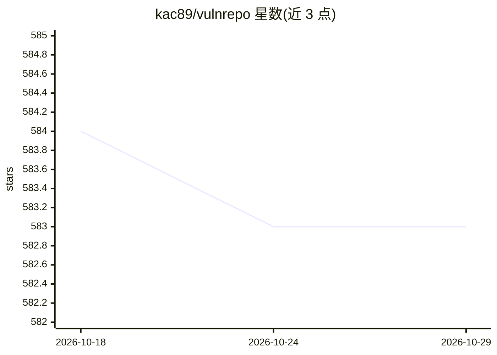

# kac89/vulnrepo

⭐ 583 · TypeScript · Apache-2.0 · 推送 2026-10-26 · [GitHub](https://github.com/kac89/vulnrepo) · [官网](https://vulnrepo.com) · 个人维护

**浏览器端加密的渗透测试漏洞报告生成与管理工具**

面向安全专业人员的客户端漏洞报告管理器：在浏览器内用 AES-256-GCM 加密报告并存于 IndexedDB，默认不向任何服务器发送数据；支持从 Nmap/Nessus/Burp/OpenVAS/Trivy/Semgrep 等扫描工具导入结果，可导出 HTML/加密 HTML/DOCX/TXT，内置 OWASP ASVS 4、PCI DSS 4、TBHM 检查清单与 CVE 查询。AI 部分：可接入本地 Ollama 模型做 AI 辅助报告撰写，数据不发送云端。提供在线版、Docker 镜像与 Angular 源码构建；不支持隐私浏览模式。

## 筛选速览

| 维度 | 判定 | 备注 |
|---|---|---|
| AI 角色 | `ai-enhanced` | 去掉 AI 部分产品仍成立 |
| 许可风险 | `permissive` | Apache-2.0 |
| 部署形态 | `self-host` | docker 或自建部署 |
| 模型依赖 | local-ok | 支持本地模型 |
| 硬件要求 | — | 无带数字的原话,不猜 |
| 安装摩擦 | `low` | 无编译、无系统依赖或容器化 |
| 成熟度 | — | 结构信号不足 |

## 能力要点

- 浏览器原生加密（PBKDF2/AES-256-GCM），密钥仅存内存并自动锁定
- 17 种扫描工具结果导入与 SARIF/Jira 导出
- OWASP ASVS 4 / PCI DSS 4 / TBHM 方法论检查清单
- 接入本地 Ollama 模型做 AI 辅助报告撰写

## 适用场景

- 渗透测试与漏洞评估后生成加密的专业报告
- 将 Nmap/Nessus/Burp 等扫描结果汇总为结构化报告
- 按 OWASP ASVS / PCI DSS 检查清单执行评估并留痕
- 用本地 AI 模型辅助撰写漏洞描述，数据不出本机

## 场景标签

`网络安全` · 领域:学习与行业

## 证据(README 行号)

> L8: A client-side, privacy-first vulnerability report manager for security professionals. All data is encrypted and stor
> L37: - **AI / LLM integration** — connect a local Ollama model for AI-assisted report writing (see AI / LLM Integration)
> L111: VULNRΞPO integrates with Ollama to provide AI-assisted report writing using a locally hosted model. No data is sen

## 星数曲线

2026-10-18 584 → 2026-10-29 583（-1）

---
*卡片 v1 · prompt 1.4 · 生成 2026-10-21 · 置信度 high · 依据 README sha `04ff240f05b2` · [字段定义](../../DATASET.md)*
