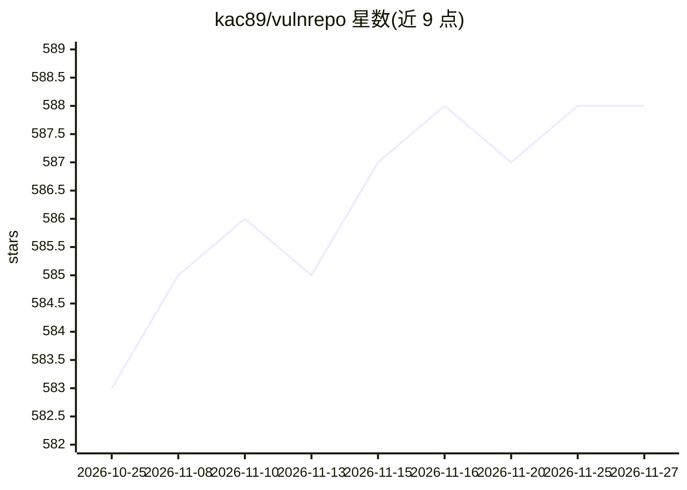

# kac89/vulnrepo

⭐ 588 · TypeScript · Apache-2.0 · 推送 2026-11-24 · [GitHub](https://github.com/kac89/vulnrepo) · [官网](https://vulnrepo.com) · 个人维护

**面向安全从业者的浏览器端加密漏洞报告生成与仓库工具**

客户端运行的漏洞报告管理器：数据在浏览器内以 AES-256-GCM 加密存于 IndexedDB，默认不经过任何服务器。支持从 Burp Suite、Nmap、Nessus、OpenVAS、Trivy 等 16 种来源导入扫描结果，内置 CVE/CWE/MITRE ATT&CK/PCI DSS 模板与 OWASP ASVS 4、TBHM 检查清单，导出 TXT/HTML/DOCX/加密 HTML 及 Jira/SARIF，提供版本快照差异对比、选择性还原、变更日志与报告分享。AI 部分为连接本地 Ollama 模型辅助撰写报告，无云端调用。可通过 npm 源码构建、Docker 镜像或安装为离线 PWA 使用。

## 筛选速览

| 维度 | 判定 | 备注 |
|---|---|---|
| AI 角色 | `ai-enhanced` | 去掉 AI 部分产品仍成立 |
| 许可风险 | `permissive` | Apache-2.0 |
| 部署形态 | `self-host` | docker 或自建部署 |
| 模型依赖 | local-ok | 支持本地模型 |
| 硬件要求 | — | 无带数字的原话,不猜 |
| 安装摩擦 | `low` | 无编译、无系统依赖或容器化 |
| 成熟度 | — | 结构信号不足 |

## 能力要点

- 浏览器端 AES-256-GCM 加密，数据仅存本地 IndexedDB，无服务器密钥恢复
- 16 种扫描器格式导入，SARIF/Jira/TXT/HTML/DOCX 多格式导出
- 报告版本快照、逐项差异对比与选择性还原
- 连接本地 Ollama 模型辅助撰写，数据不出本机

## 适用场景

- 渗透测试结束后生成并交付加密漏洞报告
- 汇总 Nmap/Nessus/Burp 等多源扫描结果统一管理漏洞
- 隔离网络环境（气隙实验室）中离线编写报告
- 与协作者共享加密报告并跟踪版本变化

## 场景标签

`网络安全` · 领域:学习与行业

## 证据(README 行号)

> L8: A client-side, privacy-first vulnerability report manager for security professionals. All data is encrypted and stor
> L37: - **AI / LLM integration** — connect a local Ollama model for AI-assisted report writing (see AI / LLM Integration)
> L158: VULNRΞPO integrates with Ollama to provide AI-assisted report writing using a locally hosted model. No data is sen

## 星数曲线

2026-10-25 583 → 2026-11-27 588（+5）

---
*卡片 v1 · prompt 1.4 · 生成 2026-11-26 · 置信度 high · 依据 README sha `4a80fd076938` · [字段定义](../../DATASET.md)*
