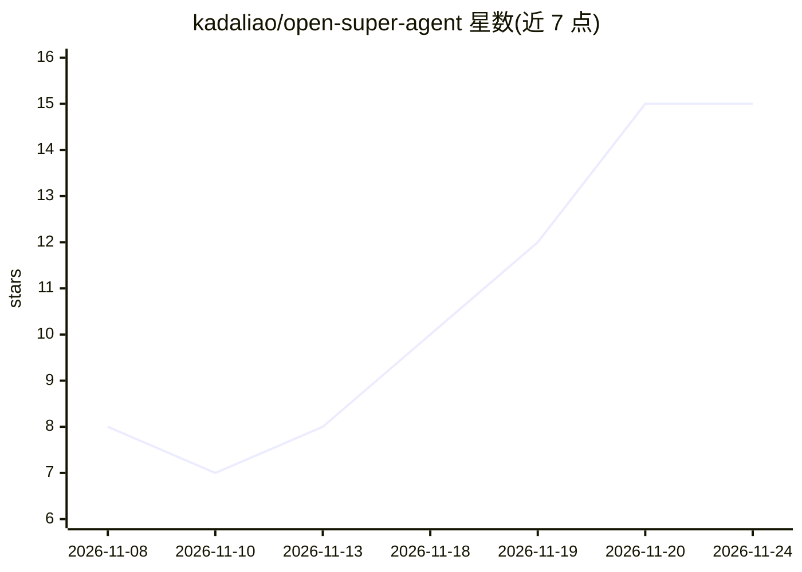

# kadaliao/open-super-agent

⭐ 15 · Python · MIT · 推送 2026-11-23 · [GitHub](https://github.com/kadaliao/open-super-agent) · [官网](https://kadaliao.github.io/open-super-agent/) · 个人维护 · 中文 README

**自托管的常驻 AI 队友：能聊天派活并操作电脑**

一个可自行部署的开源 AI 助手平台，定位为 Grok Bot 的开源替代：每个 Bot 有独立人设、记忆和对话，可在自带电脑环境里浏览网页、填表、下载文件，用户可实时观看并接手。支持后台任务、多 Bot 群聊分工、定时任务与事件、40 个应用接入及任意 MCP、技能录制与市场、费用观测页。部署方式包括 macOS 桌面 App、Docker Compose 服务器、iPhone TestFlight 内测版与聊天软件接入。密钥加密存储，关键操作需确认，数据可加密导出。

## 筛选速览

| 维度 | 判定 | 备注 |
|---|---|---|
| AI 角色 | `ai-native` | 本体是模型或模型工具 |
| 许可风险 | `permissive` | MIT |
| 部署形态 | `self-host` | docker 或自建部署 |
| 模型依赖 | local-ok | 支持本地模型 |
| 硬件要求 | — | 无带数字的原话,不猜 |
| 安装摩擦 | `low` | 无编译、无系统依赖或容器化 |
| 成熟度 | — | 结构信号不足 |

## 能力要点

- Bot 拥有自己的电脑环境：实时可见的浏览器操作，验证码/登录步骤交还用户
- 多 Bot 群聊分工与 Bot 间私信，任务自动流转
- 应用市场收录 40 个应用（Notion、Gmail、飞书、钉钉等），支持任意 MCP
- 演示一遍即整理成可复用技能，兼容导入 Claude 的 SKILL.md

## 适用场景

- 在飞书、钉钉、企业微信里让 Bot 代办查资料、填表等任务
- 给耗时任务建后台任务或定时任务，边聊边看进度
- 让多个 Bot 拉群分工完成调研与写作
- 在本机或 VPS 上私有部署并保留全部数据

## 场景标签

`AI 助手` `多智能体` `浏览器自动化` · 领域:Agent 开发

## 证据(README 行号)

> L3: **可以自己部署的常驻 AI 队友：会聊天，会派活，还有一台能看、能接手的电脑。**
> L22: - **会聊天，也会派活**：每个 Bot 有自己的人设、记忆和对话。耗时的活交给后台任务，你接着聊，每一步做了什么都看得到；几个 Bot 能拉群，一个查完资料，自动交给另一个写总结。
> L28: - **模型随便换，花多少看得到**：DeepSeek、Kimi、智谱、OpenAI、本机的 Ollama，任何兼容 OpenAI 的接口都行。“观测”页里看花了多少、做得快不快、哪里出了错，有每日预算。

## 星数曲线

2026-11-08 8 → 2026-11-24 15（+7）

---
*卡片 v1 · prompt 1.4 · 生成 2026-11-19 · 置信度 high · 依据 README sha `a8b97b8a0f68` · [字段定义](../../DATASET.md)*
