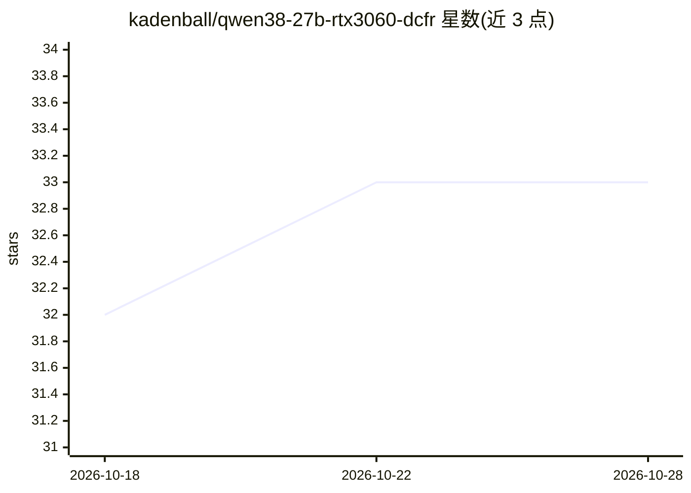

# kadenball/qwen38-27b-rtx3060-dcfr

⭐ 33 · Python · MIT · 推送 2026-10-10 · [GitHub](https://github.com/kadenball/qwen38-27b-rtx3060-dcfr) · 个人维护

**在单张低显存 NVIDIA GPU 上跑 Qwen 27B 的实验性推理优化工具**

基于 llama.cpp 的实验性 fork/补丁集，面向内存受限硬件的本地大模型推理：提供 cache-safe 投机解码（D-CFR）、CPU-GPU 排队权重传输、选择性权重放置与 CUDA/CPU 核优化。默认发布面向特定 Qwen 27B Q3 GGUF 模型，单张 RTX 3060 12 GB、128K 上下文窗口，暴露 OpenAI 兼容 API。提供引导式 setup（自动调参 15 分钟）与手动安装两条路径，均需本地克隆构建。验证范围限于 RTX 3060 + i5-12400 + Fedora，其他硬件标注为实验性/未验证；多个环节自我声明为 experimental。

## 筛选速览

| 维度 | 判定 | 备注 |
|---|---|---|
| AI 角色 | `ai-ecosystem` | LLM/agent 周边工具 |
| 许可风险 | `permissive` | MIT |
| 部署形态 | `None` |  |
| 模型依赖 | local-ok | 支持本地模型 |
| 硬件要求 | `gpu-8g` | |
| 安装摩擦 | `medium` | 含编译或系统依赖之一 |
| 成熟度 | `idea` | |

## 能力要点

- cache-safe D-CFR 投机解码与提示复用兼容
- 排队式 CPU→GPU 权重传输与选择性权重放置
- 引导式 setup 自动检测 CUDA/编译器并做有界参数调优
- 绑定 localhost 的 OpenAI 兼容 API 服务

## 适用场景

- 在 12 GB 显存的单卡上以长上下文运行 Qwen 27B Q3 模型
- 复现仓库给出的吞吐基准测量
- 研究低显存下 CPU/GPU 混合推理的优化手段

## 场景标签

`推理引擎` · 领域:训练与推理

## 证据(README 行号)

> L7: Experimental inference-engine optimizations for running large language models
> L8: on memory-constrained hardware. Built on llama.cpp: cache-safe speculative
> L108: The server binds to localhost and exposes an OpenAI-compatible API.

## 星数曲线

2026-10-18 32 → 2026-10-28 33（+1）

---
*卡片 v1 · prompt 1.4 · 生成 2026-10-25 · 置信度 high · 依据 README sha `260a36f6f479` · [字段定义](../../DATASET.md)*
