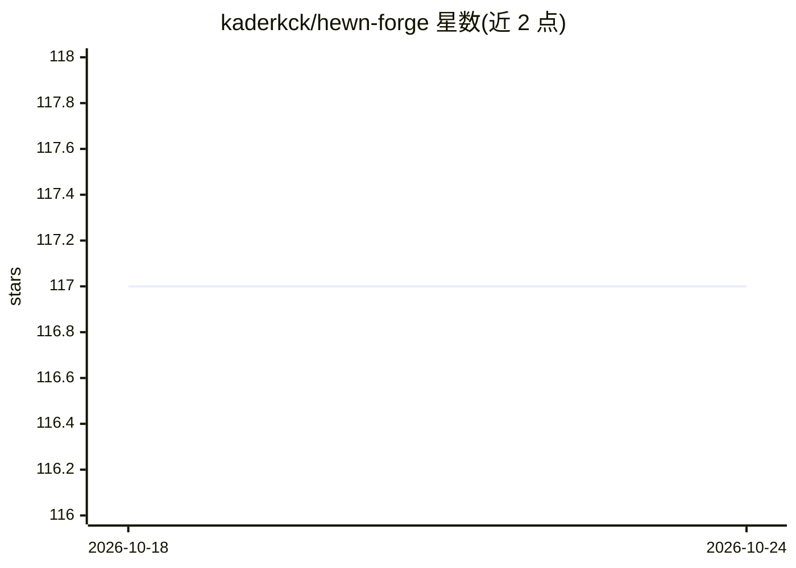

# kaderkck/hewn-forge

⭐ 117 · HTML · 推送 2026-10-23 · [GitHub](https://github.com/kaderkck/hewn-forge) · 个人维护

**对话输出塑形工具：按五种答案形态路由并纠正每轮漂移**

HEWN 定位为对话回答形态塑形系统：预定义 IR 检索、Prose+Code、Findings、Polished、Caveman 五种答案形态，由 system prompt 动态选择并在多轮间维持。核心机制是逐轮 drift-fix 钩子，从意图对齐、形态保真、上下文漂移三方面评估每轮回答并对下一轮 system prompt 施加校正权重；另含形态记忆层、45+ 语言路由、JSON/YAML 自定义形态插件与会话级加密上下文。README 未给出实际安装或运行命令，仅提供概念性上手步骤（放置 YAML 形态定义、浏览器查看 dashboard）。

## 筛选速览

| 维度 | 判定 | 备注 |
|---|---|---|
| AI 角色 | `ai-ecosystem` | LLM/agent 周边工具 |
| 许可风险 | `none` | — |
| 部署形态 | `None` |  |
| 模型依赖 | — | README 未给出锁定关系 |
| 硬件要求 | — | 无带数字的原话,不猜 |
| 安装摩擦 | `low` | 无编译、无系统依赖或容器化 |
| 成熟度 | — | 结构信号不足 |

## 能力要点

- 五种预定义答案形态（IR/Prose+Code/Findings/Polished/Caveman）
- 逐轮 drift-fix 三重评估（意图对齐/形态保真/上下文漂移）
- JSON/YAML 定义自定义答案形态的插件机制
- 声称支持 45+ 语言的形态路由

## 适用场景

- 让 AI 对话按指定格式（如带引用的研究型回答）持续输出
- 客服机器人或研究助手保持回答结构一致
- 为不同受众（初学者/管理层）切换回答的复杂度形态

## 场景标签

`提示工程` · 领域:Agent 开发

## 证据(README 行号)

> L15: Conventional conversation systems treat drift as a bug. HEWN sees it as raw material. Every off-topic turn, every t
> L47: ### 🧭 Per-Turn Drift-Fix Hook

## 星数曲线

2026-10-18 117 → 2026-10-24 117（+0）

---
*卡片 v1 · prompt 1.4 · 生成 2026-10-23 · 置信度 mid · 依据 README sha `10ea4abddcaf` · [字段定义](../../DATASET.md)*
