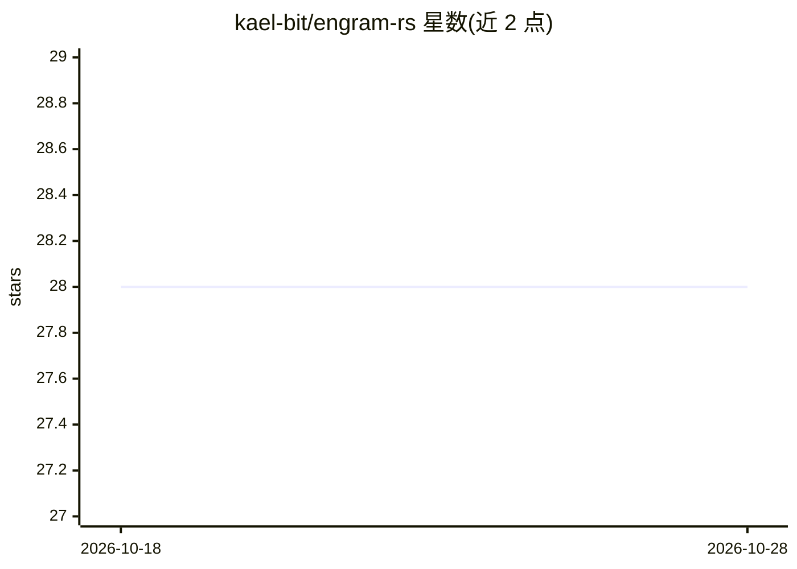

# kael-bit/engram-rs

⭐ 28 · Rust · MIT · 推送 2026-03-03 · [GitHub](https://github.com/kael-bit/engram-rs) · 个人维护 · 中文 README

**面向 AI agent 的记忆引擎：三层衰减记忆 + 自组织主题树**

单 Rust 二进制 + 单 SQLite 文件的 agent 记忆服务：时间轴上按 Buffer/Working/Core 三层管理记忆，经 LLM 质量门提升、按 Ebbinghaus 曲线衰减；空间轴上通过向量聚类自动生成 LLM 命名的主题树。提供语义嵌入 + BM25（jieba 中文分词）混合检索、语义去重合并、触发器标签、命名空间隔离、会话恢复（/resume）、17 个 MCP 工具与 HTTP API、内置 Web 面板。可无 LLM 运行（关键词检索 + 规则生命周期），配置 LLM 后解锁分诊、质量门、合并与主题命名。以 curl 安装脚本、Docker 与 npx MCP 包装方式分发。

## 筛选速览

| 维度 | 判定 | 备注 |
|---|---|---|
| AI 角色 | `ai-ecosystem` | LLM/agent 周边工具 |
| 许可风险 | `permissive` | MIT |
| 部署形态 | `self-host` | docker 或自建部署 |
| 模型依赖 | — | README 未给出锁定关系 |
| 硬件要求 | — | 无带数字的原话,不猜 |
| 安装摩擦 | `low` | 无编译、无系统依赖或容器化 |
| 成熟度 | — | 结构信号不足 |

## 能力要点

- Buffer/Working/Core 三层记忆生命周期，LLM 质量门决定提升
- 语义嵌入 + BM25（jieba 中文分词）混合检索，IDF 加权
- 向量聚类 + LLM 命名的自组织主题树，支持按主题浏览
- 单二进制约 10 MB、SQLite 存储，提供 17 个 MCP 工具与 HTTP API

## 适用场景

- 为编程 agent 接入持久记忆，跨会话保留决策与偏好
- 部署前通过触发器标签召回历史教训
- 多项目共用单实例，用命名空间隔离记忆

## 场景标签

`Agent 记忆` · 领域:Agent 开发

## 证据(README 行号)

> L9: Memory engine for AI agents. Two axes: **time** (three-layer decay & promotion) and **space** (self-organizing topic
> L213: Works with Claude Code, Cursor, Windsurf, OpenClaw, and any MCP-compatible tool.

## 星数曲线

2026-10-18 28 → 2026-10-28 28（+0）

---
*卡片 v1 · prompt 1.4 · 生成 2026-10-26 · 置信度 high · 依据 README sha `422239cd1482` · [字段定义](../../DATASET.md)*
