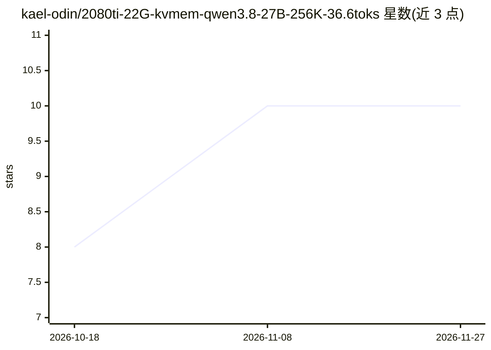

# kael-odin/2080ti-22G-kvmem-qwen3.8-27B-256K-36.6toks

⭐ 10 · Python · MIT · 推送 2026-09-29 · [GitHub](https://github.com/kael-odin/2080ti-22G-kvmem-qwen3.8-27B-256K-36.6toks) · 个人维护 · 中文 README

**给 RTX 2080 Ti 22G 单卡用户：26 万长上下文本地推理移植方案**

将 KVMem（检索式长上下文）移植到 Turing/sm_75/Windows 平台的工程仓库：基于 llama.cpp 源码打 sm_75 补丁并编译，提供 KVMem 主线（262K 上下文、36.6 tok/s 实测、IQ3+MTP+视觉）与 KV 流式无损备档两条路线，附带构建脚本、兼容层、验证脚本与完整复现链。面向想在该显卡上本地部署 27B 级模型长上下文推理的用户，含启动配方与已知限制说明。仓库不分发模型权重与 CUDA 运行库。

## 筛选速览

| 维度 | 判定 | 备注 |
|---|---|---|
| AI 角色 | `ai-ecosystem` | LLM/agent 周边工具 |
| 许可风险 | `permissive` | MIT |
| 部署形态 | `None` |  |
| 模型依赖 | — | README 未给出锁定关系 |
| 硬件要求 | `gpu-24g` | |
| 安装摩擦 | `high` | 编译与系统依赖俱全 |
| 成熟度 | — | 结构信号不足 |

## 能力要点

- KVMem 主线在 2080 Ti 22G 实测 262K 上下文、36.6 tok/s 解码
- KV 流式备档路线 260K needle-in-a-haystack 精确命中
- 提供提交号锁定的源码复现链（拉源码→打补丁→编译→验证脚本）
- 支持免编译试玩：官方 Windows 预编译与 prism.3 实验版解压即跑

## 适用场景

- 在单张 2080 Ti 22G 上本地运行 27B 级模型的长上下文推理
- 长对话 agent 场景用 KVMem 检索式方案保持解码速度
- 全文总结等精确综合任务切换到 KV 流式备档方案

## 场景标签

`推理引擎` · 领域:训练与推理

## 证据(README 行号)

> L13: > 本仓库把 KVMem（检索式长上下文）移植到 Turing / sm_75 / Windows 并公开全部实测——这是**2080 Ti 22G 单卡本地部署中，兼顾上下文长度、解码速度与模型能力的性能 / 性价比最优方案**
> L101: MIT（见 LICENSE）。KVMem 实现源自 kvmem/kvmem-llama.cpp；adaptive KV streaming 实现源自 RaymondHuang210129/llama.cpp-adaptive-k

## 星数曲线

2026-10-18 8 → 2026-11-27 10（+2）

---
*卡片 v1 · prompt 1.4 · 生成 2026-11-19 · 置信度 high · 依据 README sha `fa03ae9c699d` · [字段定义](../../DATASET.md)*
