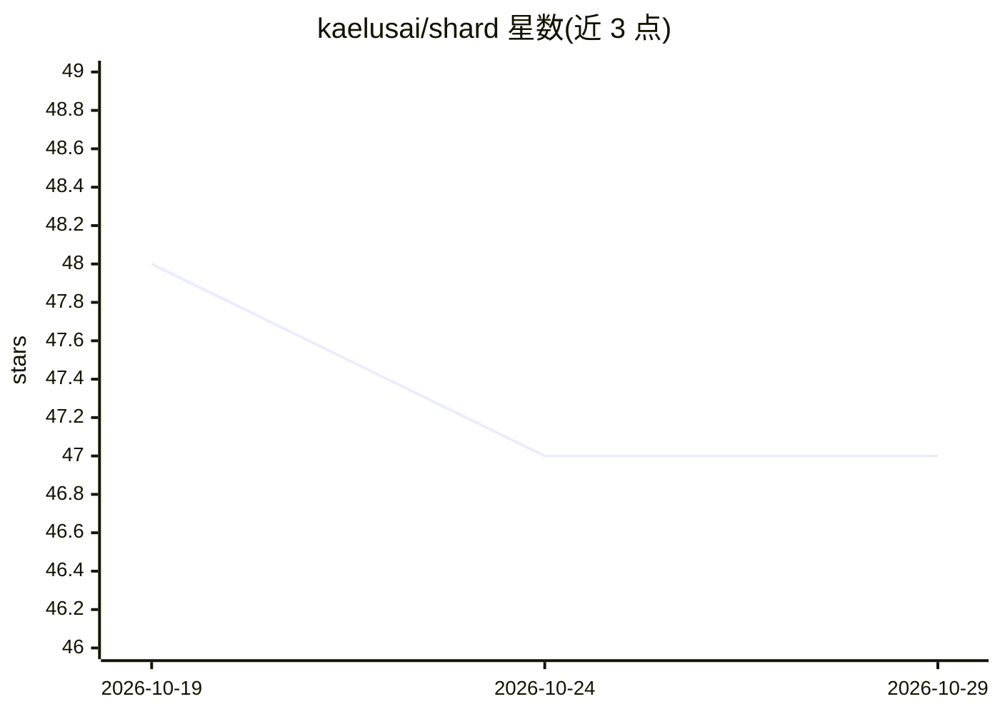

# kaelusai/shard

⭐ 47 · Kotlin · GPL-3.0 · 推送 2026-10-07 · [GitHub](https://github.com/kaelusai/shard) · [官网](https://shard.ac) · 组织维护

**Minecraft 服务器的开源 AI 反作弊插件：检测 killaura 与自瞄**

面向 Paper/Folia 服务器的战斗反作弊 Bukkit 插件，用 Kotlin 编写。通过分析玩家鼠标移动，由部署在 Shard 云端的 AI 模型检测 killaura、aim assist 等作弊行为，插件需通过 /shard connect 连接官方 Shard API 并在面板授权；提供 Flash（免费层可用）与 Pro（付费）两种模型。支持 SQLite/MySQL/MariaDB 存储、Redis 与网络告警、WorldGuard 区域排除、违规记录与惩罚规则配置，并提供实时监控命令与标注数据采集功能。运行需 Java 17+，从源码构建需 JDK 21+。

## 筛选速览

| 维度 | 判定 | 备注 |
|---|---|---|
| AI 角色 | `ai-native` | 本体是模型或模型工具 |
| 许可风险 | `viral` | GPL-3.0 |
| 部署形态 | `None` |  |
| 模型依赖 | — | README 未给出锁定关系 |
| 硬件要求 | — | 无带数字的原话,不猜 |
| 安装摩擦 | `medium` | 含编译或系统依赖之一 |
| 成熟度 | — | 结构信号不足 |

## 能力要点

- 云端 AI 模型分析鼠标移动检测 killaura/aim assist
- Flash 模型免费层可用，Pro 模型付费且检测更多作弊类型
- SQLite/MySQL/MariaDB 存储、Redis 与网络告警、惩罚规则配置
- /shard monitor 实时查看玩家 AI 数据与违规历史

## 适用场景

- 我在 Paper/Folia 服务器上检测并处罚使用 killaura/自瞄的玩家
- 实时监控可疑玩家的行为数据
- 按区域排除（如配合 WorldGuard）特定区域的 AI 检测

## 场景标签

`网络安全` · 领域:学习与行业

## 证据(README 行号)

> L30: Shard is an open-source combat anti-cheat for Minecraft servers. An AI model checks the player's mouse movement and
> L34: Shard's AI check uses the official Shard API. Create an account at app.shard.ac to get access.

## 星数曲线

2026-10-19 48 → 2026-10-29 47（-1）

---
*卡片 v1 · prompt 1.4 · 生成 2026-10-25 · 置信度 high · 依据 README sha `3a8de8175306` · [字段定义](../../DATASET.md)*
