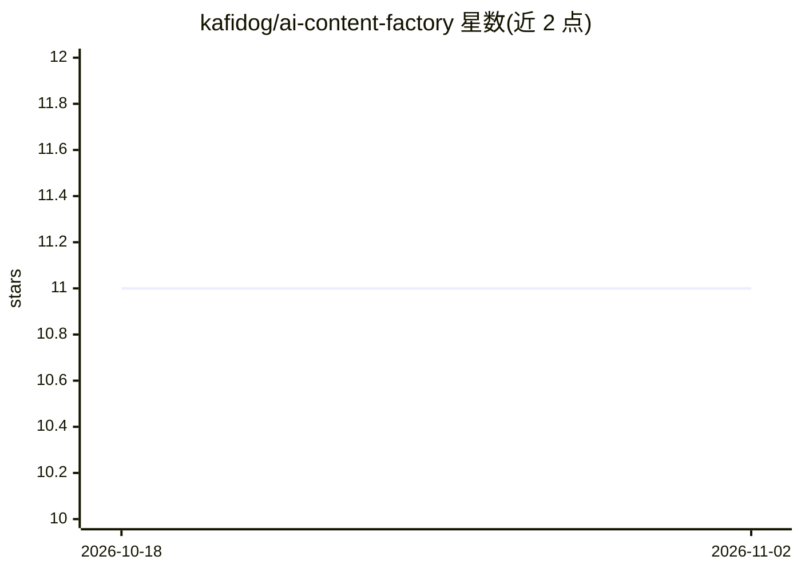

# kafidog/ai-content-factory

⭐ 11 · Python · Apache-2.0 · 推送 2026-09-19 · [GitHub](https://github.com/kafidog/ai-content-factory) · 个人维护

**离线优先、供应商中立的内容生产线：一条命令产出多平台内容包**

面向内容自动化开发者的 CLI 管线：输入一个主题，在 output/<run_id>/ 下产出研究材料、文章、脚本、分镜、媒体描述符、质量报告与七个社交平台的本地文案，并生成 demo_preview.html 可视化摘要。默认演示完全离线：不需要 API key、账号、GPU 或网络，研究内容为 fixture 占位数据，真实供应商通过实现 providers/contracts.py 协议以适配器形式接入。安全模型强制 REMOTE_WRITE=0、审批随制品变更失效、密钥与权重被发布清单排除。v0.1.0 中远程发布与真实媒体生成未包含。

## 筛选速览

| 维度 | 判定 | 备注 |
|---|---|---|
| AI 角色 | `ai-enhanced` | 去掉 AI 部分产品仍成立 |
| 许可风险 | `permissive` | Apache-2.0 |
| 部署形态 | `library` | 以包/库形式分发 |
| 模型依赖 | — | README 未给出锁定关系 |
| 硬件要求 | — | 无带数字的原话,不猜 |
| 安装摩擦 | `low` | 无编译、无系统依赖或容器化 |
| 成熟度 | `idea` | |

## 能力要点

- 单命令产出内容包：文章、分镜、媒体描述符、QA 报告与七平台文案
- 默认演示完全离线，无需 API key、账号、GPU 或网络
- 核心编排只认协议不认厂商 SDK，供应商以适配器接入
- 安全模型：REMOTE_WRITE=0 强制、审批完整性绑定、制品去重

## 适用场景

- 离线搭建可审计的多平台内容打包流程
- 用 fixture 演示验证内容管线编排后再接入真实供应商
- 需要人工审核、可追溯批准流程的内容生产工作流

## 场景标签

`工作流自动化` `AI 写作` · 领域:效率与自动化

## 证据(README 行号)

> L20: The demo proves orchestration and packaging, not factual research or generated
> L52: |Real image generation|Provider-specific|Provider-specific|Optional adapter boundary|
> L72: fixture-only and offline. Read ARCHITECTURE.md and

## 星数曲线

2026-10-18 11 → 2026-11-02 11（+0）

---
*卡片 v1 · prompt 1.4 · 生成 2026-11-02 · 置信度 low · 依据 README sha `961819086e27` · [字段定义](../../DATASET.md)*
