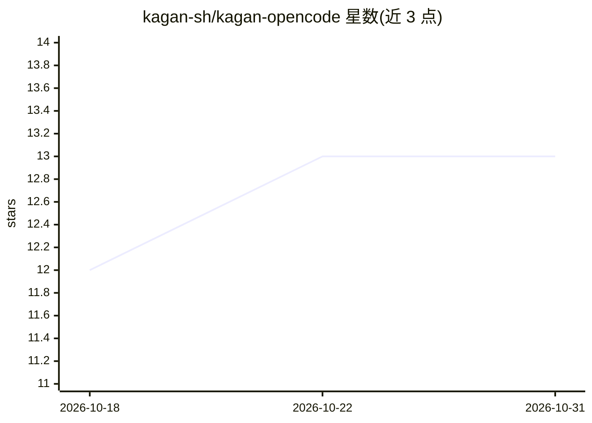

# kagan-sh/kagan-opencode

⭐ 13 · TypeScript · MIT · 推送 2026-07-28 · [GitHub](https://github.com/kagan-sh/kagan-opencode) · [官网](http://kagan.sh) · 组织维护

**OpenCode 插件：把 AI 编码代理工作变为看板上的受监督任务**

面向 OpenCode（需 1.17.13+）的插件，将 AI 编码代理的工作组织为看板任务：每个任务是一个运行于独立 git worktree 的 OpenCode 会话，沿 Backlog → In Progress → Review → Done 流转，每次状态转换设有人工关卡（代理运行前接收、批准前审查、合并由用户决定）。代理在 kagan/<slug> 分支上工作，不触碰用户检出目录；审查代理对原始任务提交分级发现，用户分诊所有发现后决定是否合并。通过 opencode plugin 命令全局安装，或以本地克隆加入配置；支持 /kagan-task 对话式建任务、npm 稳定版更新检查。MIT 许可。

## 筛选速览

| 维度 | 判定 | 备注 |
|---|---|---|
| AI 角色 | `ai-ecosystem` | LLM/agent 周边工具 |
| 许可风险 | `permissive` | MIT |
| 部署形态 | `library` | 以包/库形式分发 |
| 模型依赖 | — | README 未给出锁定关系 |
| 硬件要求 | — | 无带数字的原话,不猜 |
| 安装摩擦 | `low` | 无编译、无系统依赖或容器化 |
| 成熟度 | — | 结构信号不足 |

## 能力要点

- 任务以独立 git worktree 运行，代理不触碰用户检出目录
- Backlog → In Progress → Review → Done 流转，每次转换设人工关卡
- 审查代理对任务提交分级发现，用户分诊后决定合并去向
- 全局 npm 安装支持稳定版更新检查与确认式更新

## 适用场景

- 在 OpenCode 中以看板方式监督多个 AI 编码代理任务
- 规划多个工单时用 /kagan-task 对话式批量创建任务
- 在合并前审查 AI 代理产出并控制合并去向

## 场景标签

`编码 Agent` `代码审查` · 领域:编码与开发

## 证据(README 行号)

> L8: Kagan is an OpenCode plugin that turns agent work into supervised tasks on a kanban board. Each task is an OpenCode 
> L10: The agent never touches your checkout. It works on a `kagan/<slug>` branch in its own worktree, a reviewer agent fi

## 星数曲线

2026-10-18 12 → 2026-10-31 13（+1）

---
*卡片 v1 · prompt 1.4 · 生成 2026-10-31 · 置信度 mid · 依据 README sha `31650d7d05b4` · [字段定义](../../DATASET.md)*
