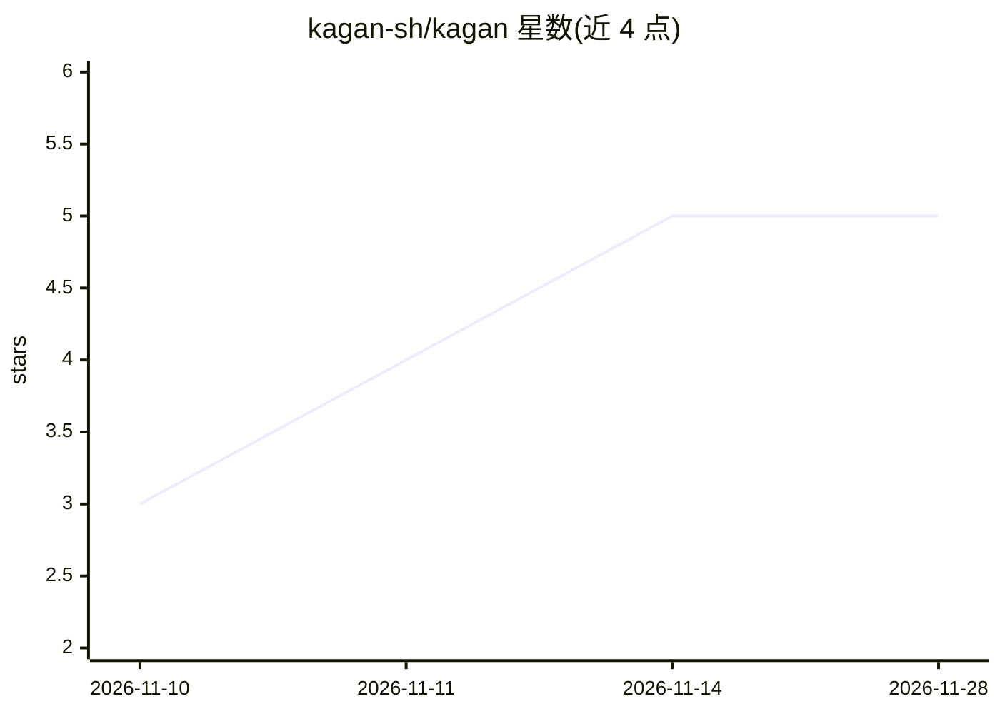

# kagan-sh/kagan

⭐ 5 · Rust · Apache-2.0 · 推送 2026-11-27 · [GitHub](https://github.com/kagan-sh/kagan) · [官网](https://kagan.sh) · 个人维护

**运行 AI 编码 agent 的开源跨平台桌面应用**

面向使用 AI 编码助手的开发者的桌面应用：以线程（threads）组织任务，内嵌终端运行 Claude Code、Codex 等 agent，右侧展示变更文件供审查，并为每个任务在独立 Git worktree 中工作以保证项目目录不变。通过插件扩展并需用户批准后生效，无账号、不发送遥测，数据存于本地 ~/.kagan 目录。支持 macOS/Windows/Linux 安装包及 Homebrew 安装。

## 筛选速览

| 维度 | 判定 | 备注 |
|---|---|---|
| AI 角色 | `ai-ecosystem` | LLM/agent 周边工具 |
| 许可风险 | `permissive` | Apache-2.0 |
| 部署形态 | `desktop` | 安装包/桌面程序 |
| 模型依赖 | — | README 未给出锁定关系 |
| 硬件要求 | — | 无带数字的原话,不猜 |
| 安装摩擦 | `low` | 无编译、无系统依赖或容器化 |
| 成熟度 | `idea` | |

## 能力要点

- 内嵌终端运行 Claude Code、Codex 等编码 agent
- 每个 git 仓库任务使用独立 worktree，项目目录不被改动
- 插件需用户批准才生效，agent 不可删除线程
- 无账号、无遥测，数据保存在本地 .kagan 目录

## 适用场景

- 在桌面界面中并行管理多个 AI 编码任务线程
- 审查 AI agent 产生的文件变更后再合入主目录
- 为需要隔离环境的仓库任务自动创建 git worktree

## 场景标签

`编码 Agent` · 领域:编码与开发

## 证据(README 行号)

> L3:  A self-extensible cross platform desktop app for AI assisted software development.
> L9: The program operates with your access. A plugin does not operate until you give approval. An agent cannot delete a t
> L11: ## Install

## 星数曲线

2026-11-10 3 → 2026-11-28 5（+2）

---
*卡片 v1 · prompt 1.4 · 生成 2026-11-21 · 置信度 high · 依据 README sha `f4d6270ea3c7` · [字段定义](../../DATASET.md)*
