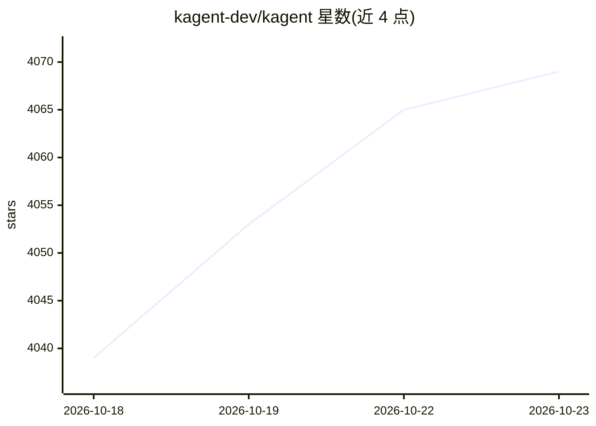

# kagent-dev/kagent

⭐ 4,069 · Go · Apache-2.0 · 推送 2026-10-22 · [GitHub](https://github.com/kagent-dev/kagent) · [官网](https://kagent.dev) · 组织维护

**Kubernetes 原生框架：在 K8s 中构建、部署、管理 AI agent**

面向 Kubernetes 用户的 AI agent 构建框架：以 Kubernetes 自定义资源（Agent/AgentTemplate/Harness/ModelConfig 等）声明式定义 agent，通过 Controller、Web UI、CLI 与 gRPC/A2A/MCP API 管理运行。支持 Go/Python ADK、Codex、Claude 等多种 Harness 运行时，接入 OpenAI、Azure OpenAI、Anthropic、Vertex AI、Ollama 等多种 LLM 提供方；内置面向 Kubernetes、Istio、Helm、Argo 等 MCP 工具，会话与历史存储于 PostgreSQL，支持 OpenTelemetry 追踪与 GitOps 部署。

## 筛选速览

| 维度 | 判定 | 备注 |
|---|---|---|
| AI 角色 | `ai-ecosystem` | LLM/agent 周边工具 |
| 许可风险 | `permissive` | Apache-2.0 |
| 部署形态 | `None` |  |
| 模型依赖 | local-ok | 支持本地模型 |
| 硬件要求 | — | 无带数字的原话,不猜 |
| 安装摩擦 | `low` | 无编译、无系统依赖或容器化 |
| 成熟度 | — | 结构信号不足 |

## 能力要点

- 以 Kubernetes CRD 声明式定义 agent，兼容 kubectl 与 GitOps 工作流
- 多 Harness 运行时：Go/Python ADK、Codex、Claude 与自定义运行时
- 多种 LLM 提供方：OpenAI、Azure OpenAI、Anthropic、Vertex AI、Ollama 及 AI 网关自定义模型
- 内置 Kubernetes/Istio/Helm/Argo/Prometheus 等工具的 MCP Server，支持 OpenTelemetry 追踪

## 适用场景

- 在 Kubernetes 集群中以 GitOps 方式部署和管理 AI agent
- 让 agent 通过 MCP 工具操作 K8s、Helm、Argo 等云原生设施
- 需要会话持久化、检查点与可观测性的 agent 运维场景

## 场景标签

`Agent 框架` · 领域:Agent 开发

## 证据(README 行号)

> L24: **kagent** is a Kubernetes native framework for building AI agents. Kubernetes is the most popular orchestration pl
> L47: - **Harnesses**: A Harness defines how an agent runs. Kagent supports its own Go and Python ADKs, Codex, Claude, an
> L48: - **LLM Providers**: Kagent supports multiple LLM providers, including OpenAI, Azure OpenAI, Anthropic, Google Vert

## 星数曲线

2026-10-18 4,039 → 2026-10-23 4,069（+30）

---
*卡片 v1 · prompt 1.4 · 生成 2026-10-20 · 置信度 high · 依据 README sha `e1f158ff5343` · [字段定义](../../DATASET.md)*
