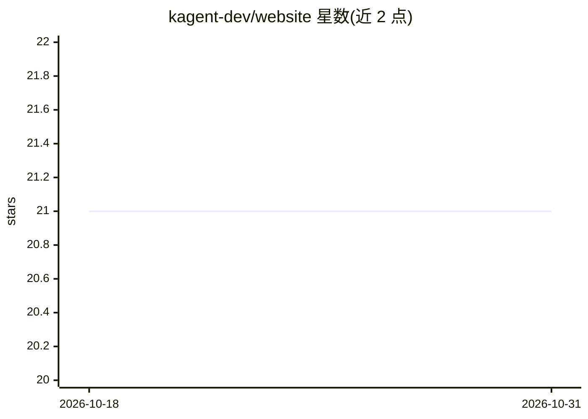

# kagent-dev/website

⭐ 21 · TypeScript · Apache-2.0 · 推送 2026-10-29 · [GitHub](https://github.com/kagent-dev/website) · [官网](https://kagent.dev) · 组织维护

**Kubernetes 原生 AI agent 框架 kagent 的官网与文档仓库**

kagent-dev/kagent 项目的网站与文档仓库，内容为 kagent 框架的介绍、本地开发说明与贡献指南。kagent 定位为 Kubernetes 原生的 AI agent 构建框架，用于在 Kubernetes 上构建、部署和管理 AI agent。README 未提供框架本体的安装命令或 API 用法，指向 DEVELOPMENT.md 说明本地运行网站的方式，并列出 Adopters 章节与 Discord 社区入口。本仓库本体是文档站点，不是框架代码。

## 筛选速览

| 维度 | 判定 | 备注 |
|---|---|---|
| AI 角色 | `ai-ecosystem` | LLM/agent 周边工具 |
| 许可风险 | `permissive` | Apache-2.0 |
| 部署形态 | `None` |  |
| 模型依赖 | — | README 未给出锁定关系 |
| 硬件要求 | — | 无带数字的原话,不猜 |
| 安装摩擦 | `low` | 无编译、无系统依赖或容器化 |
| 成熟度 | — | 结构信号不足 |

## 能力要点

- kagent 框架的官方文档与网站仓库
- kagent 定位为 Kubernetes 原生 AI agent 构建框架
- 含本地开发说明（DEVELOPMENT.md）与 Adopters 章节

## 适用场景

- 查阅 kagent 框架的文档与介绍
- 参与 kagent 网站或框架的贡献开发
- 通过 Discord 加入 kagent 社区

## 场景标签

 · 领域:云原生/AI agent 基础设施

## 证据(README 行号)

> L7: **kagent** is a Kubernetes native framework for building AI agents. Kubernetes is the most popular orchestration pla

## 星数曲线

2026-10-18 21 → 2026-10-31 21（+0）

---
*卡片 v1 · prompt 1.4 · 生成 2026-10-28 · 置信度 low · 依据 README sha `34ceedbd4f5b` · [字段定义](../../DATASET.md)*
