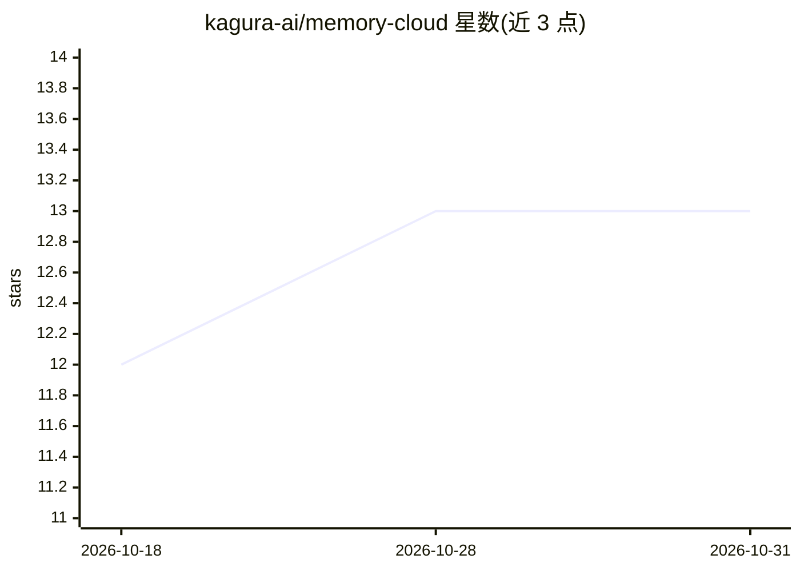

# kagura-ai/memory-cloud

⭐ 13 · Python · Apache-2.0 · 推送 2026-10-30 · [GitHub](https://github.com/kagura-ai/memory-cloud) · [官网](https://www.kagura-ai.com) · 组织维护 · 中文 README

**面向 AI agent 与团队的自托管自适应记忆 MCP 服务器**

自托管的 MCP 记忆服务器：通过 remember/recall/explore 等 72 个 MCP 工具为 Claude、ChatGPT、Gemini 等 MCP 客户端提供跨会话记忆存储与检索。检索采用混合搜索（语义 + BM25）+ 可选 AI 重排序（Ollama/vLLM 本地或 Voyage AI/Cohere），并以 Hebbian 学习在后台构建神经记忆图，recall 时自动强化共现记忆的连接。技术栈为 FastAPI + PostgreSQL + Qdrant + Redis + Next.js，支持工作区、RBAC 与数据隔离；通过 git clone 与 setup.sh 部署，需要 Docker。

## 筛选速览

| 维度 | 判定 | 备注 |
|---|---|---|
| AI 角色 | `ai-ecosystem` | LLM/agent 周边工具 |
| 许可风险 | `permissive` | Apache-2.0 |
| 部署形态 | `self-host` | docker 或自建部署 |
| 模型依赖 | local-ok | 支持本地模型 |
| 硬件要求 | — | 无带数字的原话,不猜 |
| 安装摩擦 | `low` | 无编译、无系统依赖或容器化 |
| 成熟度 | `idea` | |

## 能力要点

- 72 个 MCP 工具覆盖记忆、上下文、文件、密钥等 14 类操作
- 混合搜索（语义+BM25）+ 可选自托管重排序（Ollama/vLLM）
- Hebbian 学习自动构建神经记忆图，recall 触发边强化
- 工作区隔离、RBAC、OAuth2 与 MFA 登录

## 适用场景

- 让 Claude Code 等 MCP 客户端跨会话记住团队知识
- 为 agent 提供带信任边界与状态通道的记忆底座
- 私有化部署团队共享记忆库，数据不出本地

## 场景标签

`Agent 记忆` `知识库管理` · 领域:Agent 开发

## 证据(README 行号)

> L10:  An MCP server that gets smarter every time you search:
> L21:  Works with Claude, ChatGPT, Gemini, and any MCP-compatible client.
> L50: |**72 MCP Tools**|Guide, Memory, Agent Substrate, Agent Control Plane, Neural edges, Contexts, Tags, Files (R2), An

## 星数曲线

2026-10-18 12 → 2026-10-31 13（+1）

---
*卡片 v1 · prompt 1.4 · 生成 2026-10-31 · 置信度 high · 依据 README sha `ab2f08d51b23` · [字段定义](../../DATASET.md)*
