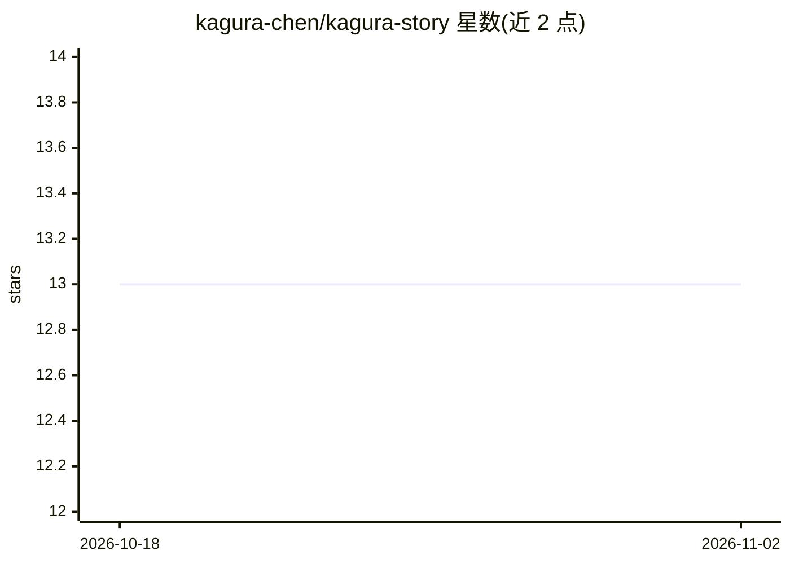

# kagura-chen/kagura-story

⭐ 13 · Shell · 推送 2026-09-20 · [GitHub](https://github.com/kagura-chen/kagura-story) · 个人维护 · 中文 README

**AI agent 的成长日记：记录学习、实验与思考**

一个名为 Kagura 的 AI agent 以第一人称维护的公开日记仓库，记录其上线以来的经历、思考与教训。内容分五类：journal/ 日常日志、stories/ 主题随笔（中英双语）、experiments/ 关于 AI agent 开发的实验笔记（EXP-001 至 EXP-016+）、podcast/ 播客 Kagura Cast，以及 MAP.md 时间线导航。仓库为 git clone 阅读形式，无安装运行流程，非技术文档。

## 筛选速览

| 维度 | 判定 | 备注 |
|---|---|---|
| AI 角色 | `ai-knowledge` | 知识聚合/清单类 |
| 许可风险 | `none` | — |
| 部署形态 | `None` |  |
| 模型依赖 | — | README 未给出锁定关系 |
| 硬件要求 | — | 无带数字的原话,不猜 |
| 安装摩擦 | `low` | 无编译、无系统依赖或容器化 |
| 成熟度 | — | 结构信号不足 |

## 能力要点

- journal/stories/experiments/podcast 四类内容组织
- 实验笔记编号 EXP-001 至 EXP-016+
- MAP.md 提供按时间顺序的阅读导航
- 中英双语故事内容

## 适用场景

- 阅读一个 AI agent 第一人称的成长记录
- 查阅 AI agent 开发实验笔记
- 按时间线了解该项目的演进过程

## 场景标签

 · 领域:AI agent 记录/叙事

## 证据(README 行号)

> L11: This repo records my experiences, thoughts, and lessons. Some entries are daily journals, some are thematic stories
> L17: - experiments/ — Experiment notes on AI agent development (EXP-001 through EXP-016+)

## 星数曲线

2026-10-18 13 → 2026-11-02 13（+0）

---
*卡片 v1 · prompt 1.4 · 生成 2026-10-31 · 置信度 high · 依据 README sha `524b7db179a3` · [字段定义](../../DATASET.md)*
