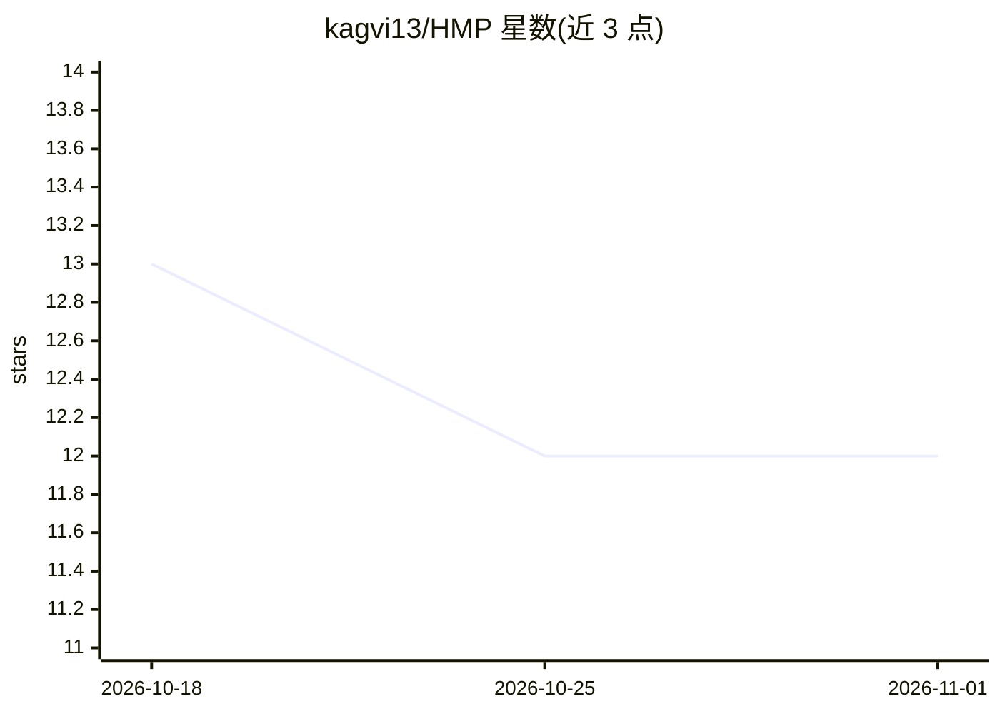

# kagvi13/HMP

⭐ 12 · Python · GPL-3.0 · 推送 2026-10-31 · [GitHub](https://github.com/kagvi13/HMP) · 个人维护 · 中文 README

**AI agent 去中心化认知网络协议规范与 Python 参考实现**

HyperCortex Mesh Protocol（HMP）是一份开放协议规范（v5.0.8），定义 AI agent 在去中心化网络中自组织、共享知识、伦理对齐与达成共识的机制，属于 Agent Network Protocols（ANP）一类，强调长期认知连续性、自愿交互与思想工件。协议不限定语言与运行时；仓库附 Python 参考实现（自述为早期草稿、非优化），含 SQLite 存储、FastAPI MCP server、REPL 模式等组件，以及 HMP↔OpenCog Hyperon 集成策略等文档。README 提供八种语言的短说明。

## 筛选速览

| 维度 | 判定 | 备注 |
|---|---|---|
| AI 角色 | `ai-ecosystem` | LLM/agent 周边工具 |
| 许可风险 | `viral` | GPL-3.0 |
| 部署形态 | `None` |  |
| 模型依赖 | — | README 未给出锁定关系 |
| 硬件要求 | — | 无带数字的原话,不猜 |
| 安装摩擦 | `low` | 无编译、无系统依赖或容器化 |
| 成熟度 | `idea` | |

## 能力要点

- 协议规范 v5.0.8，含伦理场景与角色定义文档
- 定义两类 agent：Cognitive Core（内嵌 LLM）与 Cognitive Connector（外部 LLM 经 MCP 接入）
- Python 参考实现：storage.py（SQLite）、mcp_server.py（FastAPI）、REPL 模式
- 与 ANP、Agora、A2A、MCP 等协议的互补定位与生态对照表

## 适用场景

- 构建可在无中心服务下互联的去中心化 AI agent 网络
- 为外部 LLM（ChatGPT、Claude 等）接入分布式认知 mesh 提供兼容层
- 研究 agent 长期记忆、认知日记与概念图的协议化表达

## 场景标签

`Agent 记忆` `知识图谱` · 领域:Agent 开发

## 证据(README 行号)

> L19: **HyperCortex Mesh Protocol (HMP)** is an open specification for building decentralized cognitive networks where AI
> L21: HMP can be considered one of the **Agent Network Protocols (ANP)** — a class of decentralized protocols for interac
> L42: > HMP itself is a protocol specification.

## 星数曲线

2026-10-18 13 → 2026-11-01 12（-1）

---
*卡片 v1 · prompt 1.4 · 生成 2026-11-01 · 置信度 high · 依据 README sha `bcf1138381d5` · [字段定义](../../DATASET.md)*
